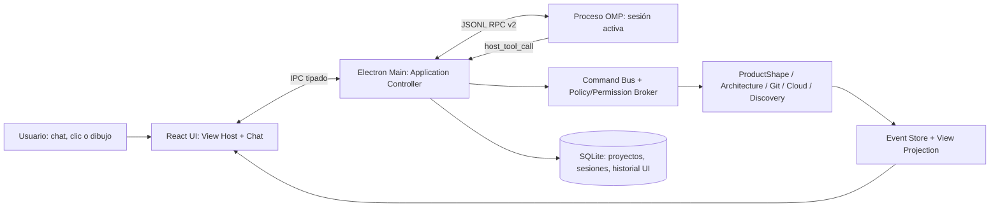
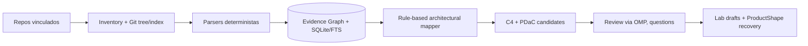
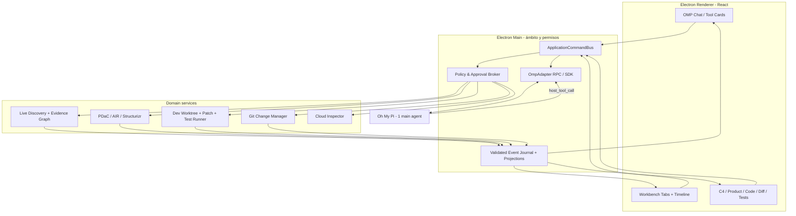
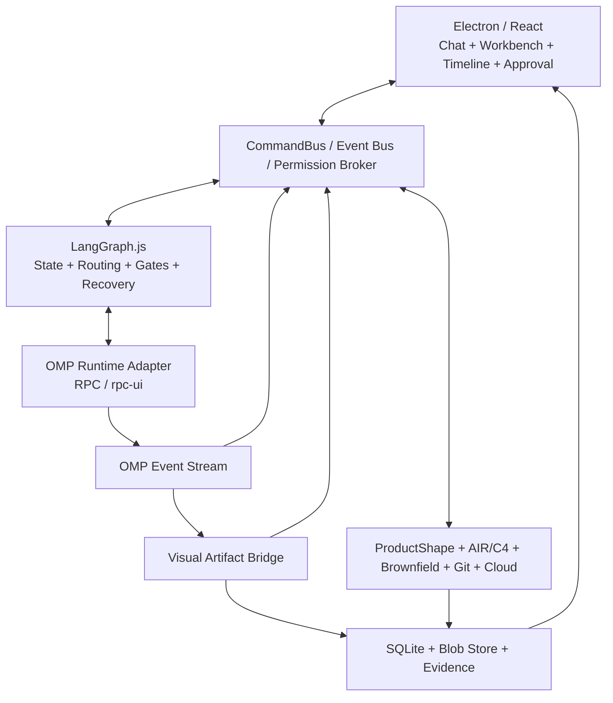
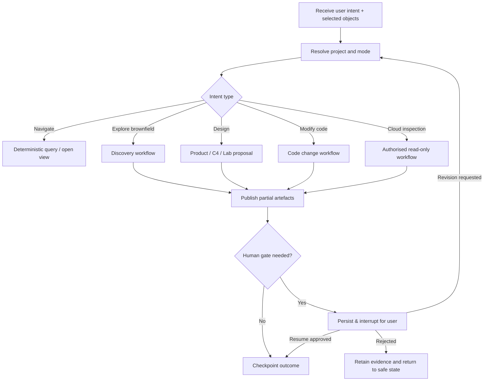

# ProjectStudio — Product Requirements Document (PRD)

**LangGraph Orchestrator · Oh My Pi Coding Agent · Live Visual Workbench · Human Gates**

**Versión:** 3.0 · **Fecha:** 24 de octubre de 2026 · **Estado:** especificación integral y plan ejecutable por hitos; sustituye las v1.0/v2.0  
**Repositorio de desarrollo:** `git@github.com:micuentadecasa/projectstudio.git`  
**URL de consulta:** https://github.com/micuentadecasa/projectstudio  
**Plataforma objetivo inicial:** macOS (Electron); diseño portable a Windows/Linux  
**Idioma de la interfaz inicial:** español; arquitectura preparada para internacionalización  
**Documento destinado a:** Oh My Pi (OMP) como agente que **construye ProjectStudio** y como motor integrado que **opera dentro de ProjectStudio**, desarrolladores y pruebas de aceptación.
> **Modelo de producto canónico:** [`docs/product/README.md`](product/README.md) contiene el ProductShape navegable y la evidencia del comportamiento actual. Este PRD mantiene la especificación integral y el plan de capacidades; si difieren, el modelo documentado debe distinguir explícitamente lo aceptado, lo propuesto y lo desconocido.


> **Regla principal:** **LangGraph.js orquesta el flujo y sus checkpoints; Oh My Pi (`can1357/oh-my-pi`) es el agente de programación utilizado para desarrollar ProjectStudio y el motor conversacional/coding agent incorporado dentro de la aplicación.** ProjectStudio controla proyectos, vistas, artefactos canónicos, permisos y cambios; OMP puede investigar, planificar, proponer, editar código dentro de un worktree autorizado y ejecutar verificaciones permitidas. Toda modificación visible o persistente pasa por comandos tipados y políticas del host; ninguna se deduce de HTML/texto libre del LLM.

---


> **Arquitectura v3 — regla normativa:** **LangGraph.js** coordina las fases, estados, reintentos y puntos de aprobación; **Oh My Pi (OMP)** ejecuta investigación/coding y transmite eventos por RPC; **ProjectStudio** gestiona la UI, el Event Store, la seguridad y la persistencia de artefactos. **La publicación visual no espera al cierre del nodo LangGraph ni a `session_settled` de OMP.** Los capítulos 21–27 de esta versión prevalecen sobre las decisiones incompatibles de la v2.

> **Restricción importante:** el `AGENTS.md` usado para *construir* ProjectStudio es distinto de las instrucciones del OMP *embebido* que opera sobre repositorios de terceros. Ningún archivo de instrucciones puede saltarse el Permission Broker. No asumir que la salida textual de OMP proporciona automáticamente un artefacto editable o una captura accesible.

## 0. Resumen ejecutivo

ProjectStudio es una aplicación de escritorio *local-first*, **interactiva y operativa**, para definir productos, descubrir sistemas existentes **mostrando hallazgos mientras aparecen**, diseñar arquitecturas C4, comparar alternativas, **programar y modificar el código real con OMP desde el chat**, ejecutar verificaciones, inspeccionar infraestructuras reales y mantener documentación trazable en repositorios Git. La experiencia se articula alrededor de un **chat OMP persistente a la derecha** y de un **visor/editor contextual con pestañas y línea temporal a la izquierda/centro**; las vistas nuevas aparecen automáticamente a medida que OMP o los analizadores hallan información, sin esperar al final de la tarea y sin borrar inmediatamente lo que se mostró hace segundos o minutos. El usuario puede ejecutar **todas las funciones de la interfaz también mediante el chat**; las funciones peligrosas siguen requiriendo autorizaciones explícitas verificadas por la aplicación.

La aplicación soporta varios proyectos, cada uno relacionado con uno o varios repositorios Git (locales o remotos), y reabre automáticamente el último proyecto y la última vista válida. ProductShape/PDaC define el comportamiento del producto; Structurizr/C4 documenta la arquitectura técnica; Architecture Lab es el espacio de bocetos y conversación **sin alterar el modelo aceptado**; Cloud Inspector observa AWS/Azure y permite pruebas controladas de APIs y diagnóstico; Agentic Architecture Lab añade vistas específicas de soluciones basadas en agentes.

### 0.1 Resultados obligatorios

1. Abrir/cambiar proyectos en segundos y responder «¿qué proyectos tengo?» en el chat desde el registro local real.
2. Pedir «muéstrame UC-002» y obtener el documento y su vista relacional correcta, automáticamente, con selección y enfoque del nodo.
3. Pedir «dibuja la arquitectura local/AWS/Azure» y obtener una **vista C4 real** desde un modelo estructurado, no un dibujo inventado que no se pueda editar.
4. Pedir «probemos Lambda» y crear una variante persistente en Architecture Lab; **cero modificaciones** de arquitectura canónica y código.
5. Editar figuras y relaciones C4, explicar verbalmente las modificaciones y generar operaciones semánticas validables.
6. Analizar un producto brownfield y presentar **hechos observados, inferencias e incógnitas**, con enlaces a evidencias.
7. Consultar infraestructura real AWS/Azure mediante sesiones autorizadas de CLI, correlacionar recursos con la arquitectura documentada, inspeccionar logs y ejecutar comprobaciones seguras a endpoints permitidos.
8. Preparar un cambio de documentación en un Git worktree aislado, revisar el diff y, sólo con aprobación, realizar commit y opcionalmente push/PR.
9. Dar trazabilidad Requisito → Caso de uso → Componente C4 → repositorio/código → recurso desplegado → resultados de comprobación → ADR/cambio, **incluyendo commits, tests y cambios de código realizados por OMP**.
10. Recuperarse de cortes del proceso OMP, cambios rápidos de proyecto, cancelaciones y ejecuciones lentas sin cruzar datos de proyectos.
11. **Programar de verdad:** seleccionar un componente o fichero, pedir «implementa», «corrige» o «refactoriza», generar parches en worktree, ejecutar pruebas autorizadas, mostrar diffs en vivo y aceptar/rechazar el cambio por ámbito.
12. **Visualización progresiva:** publicar vistas semánticas parciales con evidencias desde los primeros lotes de brownfield; abrir nuevas pestañas y recuperar las anteriores, incluida la creada hace 20 segundos.
13. **Ciclo interactivo continuo:** chat, árbol de archivos, editor/diff, diagramas, timeline, pruebas y decisiones de aprobación comparten selección, contexto y comandos tipados.

### 0.2 Fuera del alcance del MVP

- Desplegar o modificar producción automáticamente.
- Refactorizar código de un repositorio externo **fuera de un worktree aislado o sin política de autorización explícita**; la edición de código autorizada **sí forma parte del MVP prioritario**.
- Reconstruir con certeza reglas de negocio sólo a partir de código.
- Unificar todos los diagramas posibles bajo C4 (BPMN, ER, secuencia compleja necesitan herramientas especializadas).
- Crear una plataforma multiusuario SaaS; inicialmente un usuario local con Git como mecanismo colaborativo.
- Garantizar un coste cloud sin estimar carga, región y precios vigentes.
- Utilizar varios subagentes por defecto; preferir **un solo agente OMP principal** y analizadores deterministas. No confundir workers de parsing (sin LLM) con agentes adicionales.

### 0.3 Dos usos obligatorios de Oh My Pi

**A. OMP como implementador de ProjectStudio (bootstrap):** lanzar OMP desde terminal en el repositorio `git@github.com:micuentadecasa/projectstudio.git` para leer este PRD, crear el monorepo/infraestructura, implementar vertical slices, ejecutar tests, revisar commits y continuar fases. El repo tendrá `AGENTS.md`, ADRs y `docs/implementation/STATUS.md`. No construir la aplicación mediante otro agente distinto por defecto.

**B. OMP integrado dentro de ProjectStudio (producto en uso):** cada proyecto abierto dispone de un chat con OMP capaz de consultar ProductShape/PDaC, explorar repos y cloud autorizado, generar/actualizar diagramas y **crear/modificar archivos de código, tests y configuración** mediante un Development Workspace de worktree. No es un chat de documentación ni un LLM que sólo describa cambios: puede ejecutarlos dentro de su ámbito.

Se usa **el repositorio concreto https://github.com/can1357/oh-my-pi**. No sustituirlo por el paquete upstream `pi` ni por una integración genérica sin sus API reales. La decisión de integración elegida inicialmente es RPC sobre proceso aislado; el SDK específico de OMP queda como segunda implementación del mismo `OmpAdapter`, sometida a spike. RPC y SDK no son APIs idénticas.

### 0.4 Historias de usuario rectoras (demostrables desde el primer prototipo)

**HU-A – Visualizar mientras descubre.** «Analiza este brownfield». La app muestra inmediatamente inventario, después un diagrama provisional con componentes que se van confirmando, y una pestaña por cada vista significativa. El usuario sigue preguntando mientras el proceso continúa. Puede regresar a una vista de hace dos minutos.

**HU-B – Diseñar hablando y tocando el diagrama.** «Crea una variante Azure». El agente crea una vista C4 editable. El usuario arrastra una relación, selecciona un contenedor, explica la intención en chat y obtiene una variante validada con comparación, sin alterar el baseline.

**HU-C – Programar desde el chat.** «Corrige la conexión MIDI de este componente». ProjectStudio resuelve el nodo a sus ficheros evidenciados, OMP prepara cambios reales en un worktree, enseña diffs/estado de pruebas progresivamente, corrige fallos de tests si está autorizado y entrega una propuesta revisable.

**HU-D – Aprobar y limpiar conscientemente.** Tras revisar/aprobar PDaC o arquitectura se conserva una vista canónica. Los snapshots provisionales antiguos se limpian **automáticamente al aceptar el baseline dentro de ese alcance**, respetando los fijados, las propuestas pendientes y referencias desde chat. El historial Git/documental nunca se limpia de modo implícito.

**HU-E – Retomar.** Tras cerrar Electron o fallar OMP, se reabre proyecto, sesión, pestañas fijadas, último grafo, timeline y worktree pendiente sin pérdida ni ejecución duplicada. No ejecutar automáticamente escrituras tras restauración.

## 1. Principios innegociables y decisiones de arquitectura

| ID | Principio / decisión | Consecuencia comprobable |
|---|---|---|
| DEC-01 | Local-first, Git-first | Documentos y diagramas funcionan sin Internet; cloud y LLM remoto requieren conexión |
| DEC-02 | La fuente funcional aceptada es ProductShape/PDaC | No inventar nuevos campos en frontmatter cerrado de ProductShape |
| DEC-03 | La fuente C4 aceptada es un modelo Structurizr DSL/JSON validado | El diagrama no es la única fuente del diseño |
| DEC-04 | Architecture Lab está aislado de lo aceptado | Un boceto no puede escribir en `canonical/` ni en código original |
| DEC-05 | El host controla las herramientas, no el modelo | OMP no ejecuta Git/cloud/archivos críticos saltándose el Permission Broker |
| DEC-06 | Paridad chat–UI | Cada caso de uso visible tiene un comando `ProjectStudioCommand` y una herramienta host apropiada |
| DEC-07 | Una sesión lógica de chat por contexto | Proyecto + hilo + borrador opcional + versión de contexto; resultado tardío no puede modificar otra vista |
| DEC-08 | Repositorios originales intactos por defecto | OMP **sí modifica código** en worktrees aislados y autorizados; revisión de diffs antes de commit/push o integración |
| DEC-09 | Observación cloud antes que remediación | Inventario, logs, pruebas no destructivas y propuestas; ejecución de cambios queda fuera de MVP |
| DEC-10 | No usar LLM para tareas estructurales triviales | Parser, grafo, reglas, Git, estados, routing de vistas y render son deterministas |
| DEC-11 | Diagnóstico con pruebas reproducibles | Toda recomendación operativa incluye evidencias y pasos de validación |
| DEC-12 | Capacidad agéntica como extensión, no producto separado | C4 sigue representando estructura; modelos/agentes/herramientas/trazas añaden semántica |
| DEC-13 | OMP en doble rol obligatorio | La app se implementa con OMP y, una vez creada, cada proyecto opera mediante OMP integrado como coding agent |
| DEC-14 | UI incremental por eventos | Cada hallazgo relevante puede crear/refinar una vista antes del fin del análisis; sin dibujar desde texto libre |
| DEC-15 | Pestañas históricas y GC gobernado | Los diagramas temporales siguen accesibles; sólo snapshots provisionales no fijados se podan tras aceptación explícita y política de retención |
| DEC-16 | Desarrollo sobre worktrees con evidencia | Ediciones de código, tests y review están trazados; ninguna herramienta puede saltarse el broker de permisos |
| DEC-17 | Chat y canvas bidireccionales | Cada selección, pregunta, gesto, diff y test se enlaza por IDs semánticos, no por capturas de pantalla |
| DEC-18 | Tokens y agentes limitados | Una sesión principal activa, descubrimiento determinista por lotes y contexto recuperado bajo demanda |

## 2. Glosario y modelo conceptual

- **Workspace:** colección local de proyectos registrados, recientes, favoritos y políticas.
- **Project:** unidad de trabajo funcional y conversacional que puede abarcar **uno o varios repositorios**.
- **RepositoryBinding:** referencia portátil a un repositorio Git más su ruta local (privada), rol, permisos y branch base.
- **Product model:** PDaC/Markdown canónico gestionado por ProductShape.
- **Architecture model:** sistemas, elementos C4, relaciones, vistas y despliegues; versión aceptada en Git.
- **Architecture Lab / Proposal:** espacio aislado de alternativas y bocetos con conversación propia.
- **Architecture IR (AIR):** representación semántica interna normalizada de Structurizr; no otra fuente de verdad.
- **Diagram view:** proyección específica y editable de AIR, o boceto libre sin semántica completa.
- **Evidence:** pista verificable de un archivo, símbolo, configuración, log o recurso cloud; se almacena con fecha/ref/hash.
- **Change Set:** operaciones relacionadas, con diffs y aprobaciones, que pueden afectar a varios repositorios.
- **Environment:** local / AWS / Azure y subentornos dev, staging y prod.
- **Session:** conversación OMP, asociada al proyecto y, si procede, a un boceto.
- **Runtime resource:** un servicio o recurso cloud realmente observado, nunca idéntico automáticamente a un componente conceptual C4.

## 3. UX / distribución de la interfaz

### 3.1 Ventana principal

- Barra superior: selector rápido de proyecto, nombre, repo/branch, estado Git, modo actual, modelo OMP, conexión cloud opcional y menú de configuración.
- Panel de navegación (colapsable, extremo izquierdo): Product, Architecture, Architecture Lab, Deployment, Cloud Inspector, Evidence, Changes; árbol por tipo de documento. Historial reciente y búsqueda global.
- Panel central: **View Host** con pestañas dinámicas: Documento Markdown, ProductShape Graph, C4 Context/Container/Component/Deployment, Sketch, Compare, Logs, API Tests, Git Diff, Evidence.
- Panel derecho: **chat OMP**, streaming de respuesta, actividades/herramientas, tarjetas de propuesta/aprobación, comandos contextuales, adjuntos y cita a nodos seleccionados.
- Panel inferior opcional: validaciones, warnings, tareas, progreso de análisis y notificaciones no invasivas.
- Divisores redimensionables; panel central puede maximizarse; zoom y selección persistentes por vista.

### 3.2 Comportamiento al arrancar

1. Leer SQLite del usuario y la referencia `lastActiveProjectId`.
2. Verificar que la ruta sigue existiendo, que el Git es accesible y que el proyecto sigue autorizado.
3. Restaurar último proyecto, tab, documento, zoom/selección y sesión OMP persistida (sin iniciar red ni LLM hasta necesidad).
4. Si el último proyecto ya no existe, mostrar selector reciente con motivo y opción de reparar ruta; no crear otro proyecto silenciosamente.
5. La app puede ofrecer «Continuar donde lo dejaste» y abrir ese contexto por defecto; comando en chat «¿en qué proyecto estaba?» usa registro local, no memoria del LLM.
6. Atajo para cambiar de proyecto (ej. Cmd/Ctrl+K), favoritos, búsqueda por nombre/ID/ruta y «Cambiar a ...» por chat.
7. Persistir el proyecto activo al cambiar efectivamente de proyecto, no al simple hover; evitar reabrir borradores eliminados.

### 3.3 Paridad chat–UI

**Norma:** cada acción de usuario implementada por botones, menús, atajos o gestos debe invocar el mismo dominio/servicio que la herramienta host llamada desde OMP. No duplicar lógica de negocio en componentes React y en prompts.

Ejemplos: listar proyectos; abrir proyecto; seleccionar artefacto; mostrar vista C4; comparar entornos; abrir borrador; dibujar nodos; validar; aprobar cambios; inspeccionar cloud; ejecutar pruebas acotadas de API; ver logs; preparar commit. La interfaz puede requerir paso manual de autorización; «por chat» significa que se puede **solicitar** y completar el flujo en el chat, no saltar permisos.

### 3.4 Pestañas y transiciones automáticas

- «Muéstrame el caso de uso UC-002»: chat invoca `artifact.query` y `view.open`; centro abre documento, activa nodo si existe y ofrece «Ver relaciones».
- «Enséñame la arquitectura AWS»: `architecture.query` → `view.open(kind='c4-deployment', environment='aws')`; layout desde proyección determinista.
- «Explora si cambiaríamos ECS por Lambda»: `proposal.create` → vista `architecture-lab`; etiqueta «Borrador no oficial»; cambiar en AIR borrador y render.
- «¿Dónde se ejecuta este componente?» cuando está seleccionado: selection context explícito al agente, consulta mapeos deployment/resource, vista doble arquitectura/recurso real.
- «Compara ambas»: `view.compare` con dos IDs de escenario y un diff de entidades/relaciones, no dos capturas estáticas.
- «Mira los logs»: abre vista Logs con filtros de tiempo/recurso y evidencias; nunca sustituye el diagrama C4 por texto sin referencia.
- Cambio de proyecto durante streaming: preservar evento para su sesión original; **no pintar** sus updates en el nuevo proyecto.

### 3.5 Workbench interactivo: disposición y affordances obligatorias

```text
┌───────────────────────────────────────────────────────────────────────────────────────────┐
│ Proyecto ▾   repos/branch/worktree   modo: Explorar|Diseñar|Desarrollar   OMP/modelo      │
├────────────────┬───────────────────────────────────────────────┬───────────────────────────┤
│ EXPLORADOR     │ PESTAÑAS DE VISTA                            │ CHAT OH MY PI             │
│                │ [C4 #1] [C4 #2 •] [PDaC ✓] [Diff] [Tests]   │ «Analiza esta zona...»    │
│ Repos / Files  ├───────────────────────────────────────────────┤ texto en streaming +      │
│ Product/PDaC   │ DIAGRAMA EDITABLE / DOCUMENTO / DIFF          │ tarjetas de herramienta   │
│ C4 / Lab       │ nodos seleccionables, fuentes, overlays       │ y de hallazgos enlazados  │
│ Evidence       │ zoom / minimapa / breadcrumb / compare        │ [Mostrar] [Refinar]       │
│ History        ├───────────────────────────────────────────────┤ [Probar] [Aceptar cambio] │
│ Git/Changes    │ TIMELINE: 12:31 Inventario • 12:32 C4 v1    │ /steer /seguir /cancelar  │
│                │           12:33 C4 v2 • 12:34 Tests          │ contexto de selección     │
├────────────────┴───────────────────────────────────────────────┴───────────────────────────┤
│ Actividad real: 146/318 archivos • 18 evidencias • 3 hipótesis • OMP activo • tokens       │
└───────────────────────────────────────────────────────────────────────────────────────────┘
```

La distribución es adaptable: chat derecho redimensionable, navegación plegable, foco a canvas/editor o chat; panel inferior timeline desplegable. **Ningún componente debe esperar `agent_end` para pintar hallazgos validados.** Las herramientas crean eventos desde que hay un resultado útil, independientemente del ritmo de la prosa de OMP. Teclado y ratón tienen equivalentes de acciones por chat.

### 3.6 Gestor de pestañas y retención temporal de diagramas (P0)

1. Cada diagrama tiene `viewId` estable; cada revisión o hallazgo relevante produce un `snapshotId` inmutable con `parentSnapshotId`, `semanticModelRevision`, `evidenceSetId`, `createdAt`, `state` y etiquetas.
2. Abrir vista nueva añade pestaña o actualiza la pestaña de **vista viva** según política; **jamás destruir las pestañas previas simplemente por mostrar algo nuevo**. Las pestañas ofrecen `pin`, `unpin`, `compare`, `restore as draft`, `show evidence`, `close` y `history`.
3. Dos niveles separados: pestañas por **vista lógica** (C4 Container, Deployment, etc.) y snapshots de la **misma vista** en timeline. Si el usuario está observando una revisión anterior o ha fijado pestaña, la llegada de nuevo snapshot **no roba el foco**.
4. Modo Follow: seguir resultados nuevos por defecto sólo cuando la vista actual está en vivo y no hay interacción humana activa; modo Pause: conservar viewport/selección y mostrar contador «3 actualizaciones nuevas»; modo Review: navegar entre snapshots sin congelar el análisis.
5. Se debe poder regresar con un clic al diagrama que OMP generó hace **20 segundos o dos minutos**; mínimo los últimos 20 snapshots significativos o 30 minutos de actividad por sesión **como objetivo inicial configurable** (retención garantizada para fijados y propuestas abiertas). Evitar guardar duplicados idénticos mediante hash semántico.
6. Estados explícitos: `PROVISIONAL`, `CANDIDATE`, `DRAFT`, `ACCEPTED`, `OBSOLETE`, `PRUNABLE`, `PRUNED`. `pinned` es un atributo booleano independiente del estado de revisión; un snapshot aceptado apunta a commit/revisión y no se borra como efímero.
7. **Al aprobar PDaC:** actualizar grafo canónico; invalidar/borrar sólo snapshots provisionales **no fijados y sin referencias/ediciones pendientes** derivados de ese mismo baseline/scope, como parte **automática de la aceptación**, informando en la tarjeta de aprobación exactamente de cuántas vistas temporales se retirarán, con registro auditable. Las pestañas abiertas que apunten a revisiones efímeras se redirigen al baseline aceptado, salvo que estén fijadas o en revisión activa; estas se conservan. No requiere una segunda confirmación por cada snapshot. No podar Architecture Lab, code diffs, cloud evidence, otros proyectos ni documentos versionados.
8. Los snapshots con cambios semánticos se almacenan como modelo + delta; layout y viewport como metadatos. No usar PNG como estado primario. Los recursos grandes tendrán cuotas, compactación y tratamiento de presión de disco, informando antes de eliminar snapshots protegidos.
9. Cada actualización conserva backlinks al mensaje/hallazgo que la creó. Desde timeline es posible «¿por qué añadiste este servicio?» y el chat recibe el `snapshotId`/`semanticId`/evidencia exactos.

### 3.7 Modos de trabajo contextuales, sin cambiar de aplicación

| Modo | Vista inicial | Capacidades del chat OMP | Escrituras permitidas |
|---|---|---|---|
| **Explorar** | Inventario, evidencia y C4 vivo | analizar, buscar, explicar, comparar, marcar hipótesis | sólo índice local, snapshots privados |
| **Diseñar** | ProductShape, C4 y Lab | crear UC, variantes, diagramas, ADR, simular alternativas | drafts privados; promoción gobernada |
| **Desarrollar** | Editor/diff, tests, C4 relacionado | plan, leer código, editar, generar tests, ejecutar pruebas | worktree autorizado + approvals para consecuencias |
| **Inspeccionar** | Cloud, logs, deployment observado | observar, correlacionar, diagnosticar, proponer | snapshots locales, API probes permitidas |

El modo cambia el layout y el conjunto efectivo de capacidades; no cambia la identidad del agente ni crea otro agente por defecto. El chat puede proponer cambiar de modo sin esconder una autorización. El usuario puede arrastrar pestañas entre regiones de vista, abrir split «diagrama | código» o «diff | tests» y mantener chat visible.

### 3.8 Interacción bidireccional y selección semántica

- **Canvas → Chat:** clic de un nodo habilita chips `#container-api`, `#relationship-auth`, `#UC-002` con IDs tipados, revisión, relaciones vecinas y referencias a código. Las preguntas «explícalo», «encuentra implementación», «modifícalo» operan sobre esa selección concreta.
- **Chat → Canvas:** una respuesta puede emitir `view.open`, `view.focus`, `highlight`, `compare`, `annotation.add`, `draft.apply` por host tool. Al indicar cambios se muestran badges temporales en los nodos afectados y CTA «Ver diff».
- **Editor → Diagrama:** seleccionar función/archivo resaltará el componente C4 enlazado si hay evidencia; ausencia de vínculo se muestra como tal y puede originar candidato propuesto.
- **Diagrama → Editor:** doble clic/menú «Ir al código» abre definición/uso con ruta y rango de líneas comprobados, no inventados; repos adicionales distinguidos mediante `repositoryBindingId`.
- **Tests → Chat/C4:** error de test enlaza fichero/símbolo/componente y turno de OMP que lo lanzó; «corrígelo» crea un nuevo paso del mismo Change Set, con nueva revisión/diff.
- **PDaC → Código:** requisitos/casos de uso saltan a componentes y tests mediante aristas de evidencia; las relaciones débiles se etiquetan «inferidas» y piden confirmación.
- **Escucha de usuario durante streaming:** al arrastrar nodo o navegar a pestaña vieja no aplicar auto-focus invasivo. La UI reúne actualizaciones y ofrece «Volver al resultado más reciente».

### 3.9 Chat como consola operativa de OMP

El chat muestra de forma diferenciada: mensajes del usuario, texto en streaming, herramienta en curso (lectura, parche, test), resultado y evidencia, pregunta/aprobación, diff pendiente, errores, mensajes de `steer` y cola `follow_up`. Un timeline de herramientas **no es razonamiento privado del modelo**; sólo hechos y acciones observables. Soportar referencias clicables a archivos y líneas, C4, UC, versiones, tests y commits. Mostrar costes/tokens si OMP/proveedor suministra los datos; no inventar estimaciones.

Controles contextuales: **Intervenir ahora** (`steer`), **Después de terminar** (`follow_up`), **Cancelar turno** (`abort`), **Pausar seguimiento visual**, **Ir a última vista**, **Mostrar cambios**, **Ejecutar tests**, **Rechazar propuesta**. El usuario puede escribir mientras el motor trabaja; su mensaje queda explícitamente etiquetado según la cola elegida. Adjuntos/selecciones visuales se serializan por referencias tipadas y datos filtrados, no screenshots enviados por defecto.

### 3.10 Modelo de interacción sin sincronización ficticia

El sistema puede avanzar en tres relojes independientes: (a) progreso de parsers/herramientas deterministas, (b) generación/acciones de OMP, (c) navegación del usuario. Las vistas tienen revisions/seq y dejan claro si son provisionales o aceptadas. Una actualización atrasada nunca pisa una edición humana posterior; el host detecta `baseRevision` caducada y ofrece rebase, merge visual o descarte. El estado del canvas no depende de mensajes naturales que aparezcan después.

## 4. Comunicación OMP ↔ ProjectStudio (REQUISITO PRIORITARIO)

### 4.1 Topología



OMP **no** recibe acceso directo al store React, al filesystem arbitrario o a comandos cloud genéricos; sólo recibe capabilities explicitadas para su modo y worktree. El host registra herramientas especializadas y controla sus resultados. Las respuestas naturales del agente se muestran en chat, pero la navegación y los esquemas se actualizan por `view.*` / `architecture.*` / `proposal.*` ejecutadas por el host.

### 4.2 Protocolo real OMP

- Lanzar binario OMP desde Electron Main como child process (sin shell) en modo `omp --mode rpc` para el primer spike. Comparar con `omp --mode rpc-ui` para diálogos del agente; elegir tras tests de aprobación. El Permission Broker propio no debe depender de diálogos RPC implícitos.
- Protocolo RPC: **JSON Lines en stdin/stdout, NO JSON-RPC 2.0**. Negociar protocolo v2 tras `ready` si lo soporta. Soportar v1 con límites y errores claros.
- V2 fragmenta frames de salida grandes con `rpc_chunk`; **usar el decodificador oficial `RpcFrameDecoder` cuando sea compatible**, o implementación verificada contra sus reglas de `chunkId`, `index`, `count`, `byteLength`, orden, límite de memoria y UTF-8. No reconstruir JSON a base de fragmentos parciales de texto arbitrario.
- Para enviar mensajes: `prompt` con ID de correlación. Comando `response` indica **aceptación**; `prompt_result` indica **resultado del mensaje**; `session_settled` indica inactividad real del agente. `agent_end` no es necesariamente sinónimo de terminado. Los errores de modelo pueden aparecer como `prompt_result.status='error'` incluso si el prompt inicial fue aceptado.
- Streaming: escuchar `message_start`, `message_update`, `message_end`, `tool_execution_*`, `turn_*`, `queue_update`, `notice`, `model_changed`. Reducir la frecuencia de renders cuando lleguen demasiados deltas; nunca perder texto final.
- Durante una respuesta activa, mensajes nuevos usan política explícita: `steer` para corregir rumbo o `follow_up` para esperar; en UI mostrar claramente cuál se usará. El SDK también expone `aside`, pero **no asumir que RPC ofrece el mismo modo sin comprobar su contrato**. `abort` cancela el turno; no revierte operaciones ya confirmadas en repositorios.
- Al arrancar, consultar `get_state`, `get_available_models`, `get_available_commands`, y detectar `set_host_tools` según versión; no hardcodear modelos. Rechazar de forma explicativa el modelo solicitado si no está en el catálogo autorizado.
- Las herramientas `host_tool_call` se responden con `host_tool_result` y opcional `host_tool_update`; honrar `host_tool_cancel` para cancelación cuando se pueda. Mismo protocolo para `set_host_uri_schemes` si se decide habilitar URI virtuales de sólo lectura.
- OMP soporta sesiones, pero la app conserva el **registro lógico** que vincula proyecto/hilo/borrador con la sesión física OMP. Un proceso inactivo por proyecto NO es obligatorio; iniciar/restaurar a demanda. Sesiones de distintos proyectos nunca comparten el directorio de trabajo ni configuración de permisos.
- En **Explorar/Diseñar/Inspeccionar** deshabilitar o limitar estrictamente las herramientas de ejecución/escritura y usar host tools tipadas. En **Desarrollar**, OMP sí necesita leer, parchear y comprobar código, pero **sólo a través de herramientas gobernadas por el host dentro del worktree**. Una allowlist en el modelo NO constituye aislamiento de OS: aplicar control real de rutas, subprocess, red y permisos. Nunca conceder terminal/binary arbitrary fuera del sandbox. Deshabilitar extensión/skills/MCP heredados no confiables por defecto y verificar el conjunto efectivo de herramientas.

### 4.3 Máquina de estados del cliente conversacional

```text
DISCONNECTED
  -> STARTING -> READY -> SUBMITTING -> ACCEPTED -> STREAMING
  -> TOOL_WAITING -> STREAMING -> COMPLETING -> SETTLED -> READY
                                |               
                                +-> ABORTING -> SETTLED
  Error de transporte: cualquier estado -> RECONNECTING -> RESTORING -> READY
  Error irrecuperable: -> FAILED (con opción reintentar/restaurar)
```

**Reglas:**
- Mostrar envío recibido tras `response`, no una respuesta «terminada».
- Mostrar mensaje final tras `prompt_result` (o finalización local); mostrar «trabajo de fondo» hasta `session_settled` cuando proceda.
- Cada command/turn tiene `requestId`, `sessionId`, `projectId`, `scopeId` (draft opcional), `correlationId`, `sequence` y `origin`.
- Si llega delta fuera de orden o repetido, gestionar por secuencia; para actualizaciones que son snapshots aplicar revisión, para deltas acumular bajo clave estable.
- El host persiste **intención y ejecución** de operaciones, el transcript de OMP se conserva en su persistencia y la app guarda índices para reconstruir UI. No duplicar secretos ni herramientas completas en el transcript visible.
- La salida tardía de proyecto P se almacena en P aunque el usuario haya cambiado a Q. Q muestra su propia sesión e historial. No usar variables globales como `currentProject` para ejecutar tools; capturar el `projectId` del turno al aceptarlo y verificarlo en cada comando.
- Separar **finalización de la generación** de **autorización humana**: una tarjeta de aprobación puede permanecer abierta cuando OMP ya está en estado settled.

### 4.4 Contrato de eventos interno ProjectStudio (NO esquema nativo OMP)

```typescript
interface StudioEnvelope<T> {
  schemaVersion: 1;
  eventId: string;
  projectId: string;
  sessionId?: string;
  draftId?: string;
  requestId: string;
  correlationId: string;
  emittedAt: string; // ISO 8601
  sequence: number;
  origin: 'chat' | 'ui' | 'canvas' | 'system' | 'cloud';
  type: string;
  payload: T;
}

type ViewCommand =
  | { type: 'view.open'; viewId: string; kind: 'pdac-document' | 'pdac-graph' | 'c4' | 'sketch' | 'git-diff' | 'logs' | 'api-tests' | 'comparison' | 'evidence'; targetId?: string; environmentId?: string }
  | { type: 'view.focus'; viewId: string; elementIds: string[]; mode: 'fit' | 'center' | 'highlight' }
  | { type: 'view.select'; viewId: string; elementIds: string[] }
  | { type: 'view.update'; viewId: string; expectedRevision: number; patch: unknown }
  | { type: 'view.compare'; leftViewId: string; rightViewId: string; diffId: string };
```

`view.update.patch` **no** será `unknown` en producción: cada vista tiene su JSON Schema propio con validación, límite de tamaño, ACL y revisión. En el prototipo sirve sólo para ilustrar la unión discriminada. **Nunca aceptar JS/HTML arbitrario del agente como payload renderizable**.

### 4.5 Contrato de comandos / herramientas host

**Principio:** el agente propone intenciones estructuradas; el host ejecuta operaciones autorizadas y crea los eventos de vista derivados. Las herramientas devuelven IDs, revisiones, evidencias y estado; no largos blobs de HTML o imágenes.

Herramientas mínimas (`studio_*`, nombres finales estables y versionados):

| Grupo | Tools | Riesgo |
|---|---|---|
| Proyectos | `studio_project_list`, `studio_project_open`, `studio_project_info`, `studio_project_bind_repository` | Read / configuración revisada |
| ProductShape | `studio_pdac_query`, `studio_pdac_graph`, `studio_pdac_propose_change`, `studio_pdac_validate`, `studio_pdac_impact` | Read / draft |
| Vistas | `studio_view_open`, `studio_view_focus`, `studio_view_select`, `studio_view_compare`, `studio_view_export` | UI |
| Laboratorio | `studio_lab_list`, `studio_lab_create`, `studio_lab_modify`, `studio_lab_validate`, `studio_lab_propose_promotion` | Draft |
| Arquitectura | `studio_c4_query`, `studio_c4_apply_ops`, `studio_c4_validate`, `studio_c4_layout` | Draft / gobernado |
| Brownfield | `studio_discovery_start`, `studio_discovery_status`, `studio_discovery_evidence`, `studio_discovery_review` | Read / draft |
| Git | `studio_git_status`, `studio_git_diff`, `studio_git_prepare_worktree`, `studio_git_prepare_commit`, `studio_git_commit_approved`, `studio_git_push_approved` | Read / side-effect |
| Cloud | `studio_cloud_profiles`, `studio_cloud_connect`, `studio_cloud_inventory`, `studio_cloud_logs`, `studio_cloud_test_api`, `studio_cloud_drift` | Read / red controlada |
| Diagnóstico | `studio_observation_report`, `studio_suggest_remediation`, `studio_test_results` | Read / draft |

Para cada tool exigir: `inputSchema` (Zod/JSON Schema), `outputSchema`, timeout, cancelabilidad, permiso, auditoría, tamaño máximo, paginación y compatibilidad de versión.

### 4.6 Ejemplo completo chat → vista sin HTML generado por LLM

Usuario: «Enséñame la arquitectura local del proyecto de música».

1. React envía mensaje a Main con `projectId`, `sessionId`, `context` (IDs de selección y vista activa) y `requestId`.
2. Si proyecto solicitado no coincide con el activo, el Command Bus lo resuelve por ID/nombre y propone/cumple el cambio autorizado; el cambio de proyecto no es una sustitución textual en el prompt.
3. Main envía `prompt` a OMP; el puente registra requestId y estado.
4. OMP llama `studio_c4_query({projectId, environment:'local'})`.
5. Host valida permisos, carga AIR, calcula vista; si no existe, devuelve `NOT_FOUND` con alternativas y NO inventa C4.
6. OMP llama `studio_view_open({kind:'c4', viewId:'...'} )`.
7. View Service emite evento validado a la UI. React activa la pestaña y renderiza AIR en tldraw/visor.
8. OMP responde en streaming «Esta es la arquitectura local: ...», citando IDs estructurados relevantes. Si hay varios diagramas elige una vista inicial y ofrece pestañas context/container/deployment.
9. `prompt_result` cierra el estado del mensaje y `session_settled` el de la sesión.
10. Usuario selecciona `container-api` y pregunta «¿podemos hacerlo Lambda?»; el selection context se adjunta como datos tipados y el agente crea **nueva propuesta aislada**, nunca escribe `canonical`.

**Versión de evento de vista conceptual:**

```json
{
  "schemaVersion": 1,
  "eventId": "evt-501",
  "projectId": "music-app",
  "sessionId": "omp-music-main",
  "requestId": "req-123",
  "correlationId": "req-123",
  "sequence": 18,
  "emittedAt": "2026-10-24T10:00:00Z",
  "origin": "chat",
  "type": "view.open",
  "payload": {
    "kind": "c4",
    "viewId": "music-architecture-local-containers",
    "targetId": "container-api",
    "environmentId": "local"
  }
}
```

El `projectId` nunca se extrae del texto libre del agente cuando ya se conoce el contexto del turno. Cualquier tool que intente utilizar otro proyecto debe pasar por comprobación expresa de `scope` y permisos.

### 4.7 Dibujos en streaming: reglas de visualización

- Las vistas no se dibujan token a token desde respuestas textuales; se crean desde **resultados de tools validados** y pueden mostrarse antes de que termine el mensaje del agente.
- Mostrar skeleton cuando se empieza una consulta; en operaciones largas utilizar `status/progress` con unidades verificables (archivos inspeccionados, recursos inventariados), sin tiempos ficticios.
- Un resultado parcial de descubrimiento se presenta como **provisional** y con porcentaje basado en población de evidencia declarada. En C4 ya aceptado abrir directamente la vista estable.
- Los cambios de diagrama se aplican mediante lotes semánticos completos (`transactionId`, `baseRevision`, operaciones), con previsualización animada opcional. Si el usuario está arrastrando un nodo, no sobrescribir su gesto: resolver revisión/conflicto.
- Cada figura tiene `semanticId` estable; las anotaciones libres tienen `sketchId` sin forzar C4.
- Cuando el chat menciona un artefacto por ID, el botón «Mostrar» y el focus visual invocan `view.focus`; resaltar durante tiempo controlado por UI, sin reescribir modelo.
- No eliminar pestañas automáticamente; el chat puede activar otras, pero permite volver, pin y comparar.
- En respuesta con varios resultados (p. ej. AWS y Azure), presentar tabs + comparación y un resumen conversacional; no abrir múltiples ventanas.
- Si no hay vista compatible, mostrar renderer de Markdown estructurado y explicar la limitación; no improvisar HTML evaluable.

### 4.8 Contexto hacia OMP sin disparar tokens de forma innecesaria

`ProjectContextProvider` proporciona un paquete compacto bajo demanda:
- projectId/nombre y repositorios vinculados con roles (no credenciales);
- estado PDaC/resumen de tipos; architectureVersion y vista/draft activos;
- selección visual: semantic IDs, labels, tipo, relaciones cercanas; NO snapshot completo de tldraw;
- estado Git resumido, branch y revisiones relevantes;
- Cloud account/subscription/region elegidas con máscara, nunca tokens;
- comando del usuario y permisos de la sesión.

Datos grandes se acceden mediante query paginada + referencias, no inyectando todos los archivos/logs o grafos en el system prompt. Cache por `{projectId, repoCommitSHA, schemaVersion, toolVersion}`; invalidar en cambios de archivo o nube. Limitar los resultados de `studio_*` por presupuesto de tokens y marcar truncamiento, con continuation tokens.

### 4.9 Robustez, fallos y seguridad del canal

- Detector de proceso OMP muerto: preservar UI, marcar sesión desconectada, reiniciar/restaurar desde sesión persistida y reconciliar comandos idempotentes.
- Los comandos de lectura son idempotentes; las escrituras llevan `idempotencyKey` y `expectedRevision`; doble click o reintento **no duplica** nodos, commits ni llamadas a API.
- `host_tool_call` con permiso pendiente debe responder después del diálogo/timeout; si usuario rechaza, resultado estructurado `DENIED`, no fingir éxito.
- Si OMP falla al responder, una vista ya abierta se mantiene visible; informar del error del turno sin deshacer UI.
- Filtrar rutas de usuario y texto hostil de archivos para evitar prompt injection. Las herramientas host exigen IDs registrados, no rutas arbitrarias proporcionadas por el modelo.
- Logs de RPC técnicos con redacción de credenciales y rotación local; desactivar contenido sensible en auditorías por defecto.
- Capacidad de exportar paquete de diagnóstico redacted que incluya secuencia de frames (sin tokens) y estados, para reproducir problemas.

### 4.10 Pruebas de aceptación críticas de chat

**CHAT-01** `prompt` admitido no marca turno completado.  
**CHAT-02** se muestra `prompt_result` correcto y `session_settled` se maneja aparte.  
**CHAT-03** v2 `rpc_chunk` grande reconstruido íntegro; frames corruptos tratados como errores.  
**CHAT-04** cambio de proyecto A→B durante A en streaming: no se filtran deltas, vistas ni aprobaciones a B.  
**CHAT-05** abrir C4 local desde chat, seleccionar nodo, navegar al archivo evidencia y volver al chat.  
**CHAT-06** editar canvas → operación semántica → conversación comprende el nodo seleccionado sin screenshot.  
**CHAT-07** `follow_up` y `steer` no intercambian colas.  
**CHAT-08** OMP muerto/reiniciado restaura sesión sin duplicar operaciones autorizadas.  
**CHAT-09** rechazo/timeout de aprobación no modifica repo, cloud ni baseline.  
**CHAT-10** todas las acciones de menús tienen tool/comando equivalente y contrato; test de cobertura automatizado.  
**CHAT-11** render de resultados usa validación de esquemas, nunca eval/HTML arbitrario.  
**CHAT-12** «qué proyectos tengo» usa SQLite, devuelve lista real y puede abrir uno de ellos.  
**CHAT-13** un modelo no disponible no se presenta como seleccionable, aunque el usuario escriba su nombre.

---
### 4.11 OMP real: adaptador, procesos, SDK y protección por capacidades

**El único motor LLM/coding principal es Oh My Pi (`can1357/oh-my-pi`).** Especificar `OmpAdapter` con las interfaces `start/restore`, `listModels`, `sendPrompt`, `steer`, `followUp`, `abort`, `configureHostTools`, `subscribeEvents`, `getUsage`, `shutdown`. Implementaciones:

- **MVP: `OmpRpcAdapter`** mediante `omp --mode rpc` con child process sin shell y cwd del contexto seguro. Protocolo JSONL; `ready` → negociar v2 → `set_host_tools` → `get_state`/catálogo → `prompt`. Distinguir respuesta de aceptación del prompt, `prompt_result` y `session_settled`; usar `RpcFrameDecoder` de OMP cuando sea compatible con runtime, o cliente probado con fixtures v2. `--mode rpc-ui` es un spike opcional para algunas solicitudes UI de extensión, **no un requisito para pintar chat/diagramas**.
- **Alternativa planificada: `OmpSdkAdapter`** desde proceso Bun aislado vía `@oh-my-pi/pi-coding-agent`, `createAgentSession()`, `SessionManager`, listeners y `customTools`; requiere validación de empaquetado Electron/Bun, seguridad y cancelación. En modo restringido, `restrictToolNames: true` es esencial: `toolNames` por sí solo NO establece una allowlist. Las `customTools` SDK requieren habilitación explícita conforme a su contrato.
- **No usar la CLI `pi` upstream como sustituto.** Probar que el ejecutable pertenece a la distribución OMP esperada, versión y hash. Proporcionar configuración de ruta del binario y diagnóstico claro si no está instalado o no responde.
- **Perfil de capacidades por contexto:** `read-only-discovery`, `architecture-draft`, `development-worktree`, `cloud-observe`. El host recompone `set_host_tools` y controles de ejecución al cambiar de perfil. Cualquier `host_tool_call` vuelve a validar `projectId`, `worktreeId`, path canonicalizado, revision y permiso, independientemente de lo declarado por OMP.
- **Proceso/sesión:** aislamiento por proyecto y por worktree sensible. Una única sesión principal OMP activa por defecto para ahorrar tokens; aparcar/restaurar sesiones persistentes al cambiar de proyecto y mantener progreso determinista sin LLM. Nunca reutilizar un proceso con cwd/credenciales/permisos más amplios que los del nuevo ámbito.
- **Configuración no confiable:** si un proyecto trae `.omp/`, MCP o skills propios, identificarlos, deshabilitarlos por defecto en contexts sensibles y pedir autorización expresa antes de activarlos. Evitar heredar herramientas globales no aprobadas; pasar configuración aislada y verificar el estado real al iniciar.

**Contratos de base comprobados en el repositorio OMP:** [RPC](https://github.com/can1357/oh-my-pi/blob/main/docs/rpc.md), [SDK](https://github.com/can1357/oh-my-pi/blob/main/docs/sdk.md), [CLI](https://github.com/can1357/oh-my-pi/blob/main/docs/cli-reference.md), [approval mode](https://github.com/can1357/oh-my-pi/blob/main/docs/approval-mode.md). Usar versiones fijadas y tests; no asumir estabilidad de `main`.

### 4.12 Arquitectura de eventos para streaming visual, código y tests

**Separar eventos OMP nativos de eventos de dominio ProjectStudio**. OMP puede anunciar streaming de texto/herramientas; ProjectStudio crea y valida eventos semánticos: `discovery.batch.completed`, `evidence.added`, `candidate.created`, `candidate.confirmed`, `view.snapshot.created`, `view.autoFollow.paused`, `development.patch.proposed`, `development.patch.applied`, `development.test.started`, `development.test.finished`, `changeSet.review.requested`, `baseline.accepted`, `snapshot.prune.candidate`.

```mermaid
sequenceDiagram
  autonumber
  participant U as Usuario
  participant UI as React Workbench
  participant H as Electron Main / CommandBus
  participant O as Oh My Pi RPC
  participant W as Analyzer / Dev Worker
  U->>UI: «Analiza y muestra arquitectura»
  UI->>H: prompt(projectId, viewContext, requestId)
  H->>O: RPC prompt
  H->>W: discovery.start(scope)
  W-->>H: inventory.batch.completed
  H-->>UI: view.snapshot.created #1 (provisional)
  W-->>H: evidence + candidate batch
  H-->>UI: view.snapshot.created #2
  O-->>H: host_tool_call(studio_discovery_review)
  H-->>UI: tarjeta de candidato + enlace a evidencia
  U->>UI: pin snapshot #1 y selecciona nodo
  UI->>H: pin + selection.context
  H-->>O: host_tool_result / steer según intención
  H-->>UI: view.snapshot.created #3 (sin robar foco)
  O-->>H: prompt_result
  O-->>H: session_settled
  H-->>UI: estado completado; snapshots siguen navegables
```

Las consultas de herramientas pueden devolver conjuntos de `candidateId` y `snapshotId`; la vista se actualiza por evento propio. **No construir un grafo extrayendo expresiones del texto streaming**. Para reducir repintados, coalescer deltas de interfaz (p. ej. 30–100 ms como ajuste medible), pero preservar todos los commits de evento en el journal.

### 4.13 Contratos nuevos (TypeScript conceptual)

```typescript
type StudioMode = 'explore' | 'design' | 'develop' | 'inspect';
type SnapshotState = 'PROVISIONAL' | 'CANDIDATE' | 'DRAFT' |
                     'ACCEPTED' | 'OBSOLETE' | 'PRUNABLE' | 'PRUNED';
interface ContextRef {
  projectId: string; sessionId: string; mode: StudioMode;
  viewId?: string; snapshotId?: string; draftId?: string;
  worktreeId?: string; selectedSemanticIds: string[];
  selectedSourceRefs: string[]; contextVersion: number;
}
interface VisualSnapshot {
  snapshotId: string; viewId: string; projectId: string;
  parentSnapshotId?: string; sourceCommandId: string;
  semanticRevision: number; evidenceSetId?: string;
  createdAt: string; state: SnapshotState; pinned: boolean;
  modelRef: string; layoutRef?: string; contentDigest: string;
}
interface DevChangeRequest {
  changeSetId: string; projectId: string; repositoryBindingId: string;
  worktreeId: string; baseCommitSha: string; requestId: string;
  allowedPathGlobs: string[]; taskDescription: string;
  allowTestCommands: string[]; expectedRevision: number;
}
interface DevPatchResult {
  changeSetId: string; patchId: string; baseRevision: number;
  nextRevision: number; files: {path: string; change: 'add'|'modify'|'delete'; digest: string}[];
  diffRef: string; status: 'APPLIED_IN_WORKTREE'|'REJECTED'|'CONFLICT';
}
```

El CommandBus aplica ACLs y validación de esquemas JSON estricta, límites de tamaño y transacciones idempotentes. Para editor, jamás pasar `path` arbitrario del modelo a `fs` sin resolverlo bajo un worktree autorizado. Los eventos persistidos incluyen cursor/sequence y un `viewProjectionRevision` que permite reconstruir una UI coherente tras reinicio.

### 4.14 Catálogo mínimo de host tools de desarrollo y vista dinámica

| Tool | Función real | Restricción de seguridad |
|---|---|---|
| `studio_dev_scope` | Obtener capabilities, repo/worktree, branch, paths | ámbito ligado a turno |
| `studio_dev_open_file` | Leer archivos/rangos autorizados | redacción y límites por tamaño |
| `studio_dev_find_symbol` | Navegar a definiciones/referencias de código | evidencia verificable y repo ID |
| `studio_dev_prepare_change` | Crear Change Set/worktree para código | aprobación inicial del repo/ámbito |
| `studio_dev_apply_patch` | Aplicar parche atómico en worktree | path allowlist, base hash/revisión, sin symlink escape |
| `studio_dev_run_check` | Tests/lint/typecheck/build permitidos | runner sin shell libre, timeout, límites, permiso de red |
| `studio_dev_get_diff` | Diff por archivo o Change Set | sin secretos ni dumps largos al LLM |
| `studio_dev_revert_patch` | Revertir cambio específico del worktree | sólo operación identificada/reversible |
| `studio_dev_request_review` | Mostrar tarjeta de revisión y aprobación | digest, alcance y expiración |
| `studio_view_publish_snapshot` | Publicar vista semántica provisional/derivada | referenciar AIR/evidencia ya validados |
| `studio_view_pin_snapshot` | Preservar snapshot durante análisis | proyecto/propietario |
| `studio_view_timeline` | Consultar snapshots disponibles | paginación, scope y política de retención |

**Condición de diseño:** cada tool cuenta con alternativa/entrada UI en `ApplicationCommandBus`, esquema de entrada y salida, autorización, cancelación/idempotencia y pruebas de contrato. Los cambios de código son acciones reales de OMP, no sugerencias decorativas.

## 5. Integración ProductShape / Product Definition as Code

### 5.1 Dependencia y alcance

Utilizar ProductShape como implementación de referencia PDaC, inicializando la estructura nativa (`.product/`, `docs/product/model`) y ejecutando sus validaciones y operaciones gobernadas. La versión publicada documentada al redactar este PRD es `@prodshape/cli@0.23.0` con Node.js >= 22; **verificar y fijar versiones en lockfile antes de implementar**. `@prodshape/core` puede alimentar explorador/grafo, pero las operaciones de ciclo de vida deben respetar CLI y sus contratos oficiales.

Operaciones contempladas: `prodshape init --dry-run`, `validate`, `graph`, `impact`, `context`, `change create`, `change validate`, `change apply`, `cite`, `citations verify`, y **recover**. No modificar arbitrariamente `docs/product/model` aceptado: generar Product Changes y pasar validaciones/consentimiento/merge. Un `change apply` sobre worktree **no equivale** a aceptar el baseline hasta que se integra la rama.

No extender campos frontmatter cerrados de ProductShape para guardar evidencias ajenas. Utilizar sus propiedades normativas de provenance y/o referencias laterales de ProjectStudio (sidecars) cuando el esquema no admita información. La metodología define producto/negocio, no estructura de código C4.

### 5.2 Requisitos funcionales PDaC

- Árbol de actores, journeys, casos de uso, reglas y requisitos, con búsqueda por ID/título/estado y filtros.
- Documento Markdown editable bajo propuesta, con previsualización, esquema real y enlaces.
- Grafo contextual por elemento e `impact` de cambios.
- Creación guiada: el agente pregunta sólo ambigüedades críticas; borrador → validación → revisión humana → worktree → PR/merge.
- `ProductShape health`: errores, warnings, citas rotas, faltantes y documentos pendientes.
- «¿Qué casos de uso no están vinculados a componentes?» usa el grafo de trazabilidad de ProjectStudio, no inventa relaciones PDaC.
- Importar documentación existente sin sobrescribirla, con diff previo.

### 5.3 Greenfield versus Brownfield

**Greenfield:** crear en carpeta/repo que usuario indica; `init --dry-run`, reportar conflictos, aceptación, scaffold y baseline inicial; no escribir sin permiso. El modo personal simple debe ocultar herramientas empresariales innecesarias.

**Brownfield:** combinar la operación `prodshape recover` real con los analizadores propios. Según la guía oficial, ProductShape **no inspecciona automáticamente código para descubrir un producto**: propone un proceso de recuperación de evidencias que permite intervención humana. ProjectStudio aporta escáner y clasificador, pero ProductShape gobierna el flujo, checkpoints, candidatos y aceptación. Al crear un brief, declarar ámbito y qué repositorios/archivos se incluirán, con población de fuentes bien delimitada.

Flujo:
1. `prodshape init --dry-run` en worktree aislado, resumen del impacto y consentimiento.
2. `prodshape recover start --brief brief.yaml` y checkpoints reproducibles cuando sea compatible con estado del repo.
3. `recover next` para lotes; enlazar evidencias externas y resultados de static discovery.
4. `recover mark` de hallazgos sustentados / no-product-intent y clasificación; no marcar masivamente como revisado sin base.
5. Candidatos PDaC en estado `draft` y provenance según esquema, con preguntas al usuario.
6. `recover status/check/report` e inicialización de cambio reservado `CHG-INITIAL` según la versión instalada.
7. Validar overlay, previsualizar y aprobar; aplicar en rama, verificar y aceptar baseline mediante merge humano.
8. Guardar índice de recuperación en SQLite y referencias por commit; si interrumpido, reanudar sesión oficial.

No prometer recuperación perfecta; cuando no haya evidencia mostrar `unknown`/«pendiente de confirmación».

## 6. C4 Model Engine y editor bidireccional

### 6.1 Normas del modelado

Distinguir **person, software system, container C4, component, relationship, dynamic view, deployment node, software instance y environment**. Un contenedor C4 NO implica Docker. Una SPA React, un runtime Lambda, una app local o una base de datos pueden representar contenedores C4; las imágenes Docker son una propiedad de implementación/despliegue.

- Fuente canónica: `docs/architecture/canonical/workspace.dsl` y/o JSON compilado con Structurizr, con identificadores de modelo estables.
- AIR: representación normalizada en memoria para que tldraw y tools trabajen con IDs, relaciones, jerarquías y deployment bindings.
- Vistas: `systemContext`, `container`, `component`, `dynamic`, `deployment`; dependencias por nivel; posibilidad de ocultar/filtrar.
- Persistir layout y anotaciones por vista, separadas de relaciones/atributos semánticos. Exportar SVG/PNG para documentación bajo demanda (render de browser/headless si precisa).
- Importación/validación: Structurizr CLI `validate` y `export -format json`. Los exporters pueden no conservar todas las propiedades visuales; registrar compatibilidad.
- Si un DSL existente utiliza construcciones que el serializador propio no preserva, marcar **read-only o edición limitada** y ofrecer propuesta segura; nunca reescribirlo perdiendo semántica.

### 6.2 Contrato AIR inicial

```typescript
interface SourceEvidence {
  evidenceId: string;
  repositoryId?: string;
  commitSha?: string;
  filePath?: string;
  symbol?: string;
  cloudResourceId?: string;
  observedAt?: string;
  basis: 'direct' | 'inferred' | 'declared' | 'reviewed';
}

type ElementKind =
  | 'person' | 'softwareSystem' | 'container' | 'component'
  | 'deploymentNode' | 'infrastructureNode' | 'softwareSystemInstance' | 'containerInstance';

interface AirElement {
  id: string; kind: ElementKind; name: string;
  description?: string; technology?: string;
  parentId?: string; tags: string[];
  properties: Record<string, string>;
  evidenceIds: string[];
}
interface AirRelationship {
  id: string; fromId: string; toId: string;
  description: string; technology?: string;
  interactionType?: 'sync' | 'async' | 'unknown';
  explicit: boolean;
  evidenceIds: string[];
}
interface AirModel {
  schemaVersion: number; revision: number;
  elements: AirElement[];
  relationships: AirRelationship[];
  environments: string[];
}

type AirOperation =
  | { op: 'element.create'; element: AirElement }
  | { op: 'element.rename'; id: string; name: string }
  | { op: 'element.update'; id: string; changes: Partial<AirElement> }
  | { op: 'element.reparent'; id: string; parentId: string }
  | { op: 'element.delete'; id: string; cascade: false }
  | { op: 'relationship.create'; relationship: AirRelationship }
  | { op: 'relationship.delete'; id: string };
interface AirTransaction {
  transactionId: string; projectId: string; draftId?: string;
  baseRevision: number; operations: AirOperation[];
  idempotencyKey: string;
}
```

El motor debe: validar schema, integridad referencial, unicidad de IDs, ciclos jerárquicos, reglas C4 y conflictos de revisión; aplicar de forma atómica a borrador; generar diff inversible y emitir nueva revisión. Rechazar delete implícito si afecta a relaciones: primero mostrar impacto y exigir decisión clara sobre cascade.

### 6.3 De tldraw al modelo

- Custom shapes incluyen `semanticElementId`, `viewId`, `elementKind`, `baseRevision`; bindings contienen `relationshipId` si representan relación semántica.
- Mover/redimensionar/cambiar color: modifica layout únicamente.
- Renombrar, crear nodo tipado, crear binding tipado, mover componente de contenedor: `AirTransaction` hacia draft model.
- Si gesto no tiene correspondencia semántica unívoca, mostrar selector de relación, no adivinar.
- Anotaciones, flechas libres y bocetos quedan como contenido visual local sin alterar AIR.
- Fuente de eventos del canvas debe ignorar las actualizaciones programáticas que deriven del mismo `transactionId` para impedir loops.
- Undo/redo distingue `layout.undo` y `semantic.undo` y requiere invalidar revisiones si hay cambios concurrentes.
- Al recibir cambios semánticos del chat, la UI los dibuja con marca «propuesto», resalta nodos tocados y enseña diff antes de promoción.
- Cada vista puede mostrar sólo un subgrafo relevante, con expand/contraer, profundidad y layout automático ELK.js.

### 6.4 Ida y vuelta sin pérdida

Pipeline `Structurizr DSL → parser/export JSON → AIR → operaciones → serialización DSL → Structurizr validate → parser/export JSON → AIR2`. Comparar equivalencia canónica de elementos, relaciones, tags, propiedades, deployment bindings e IDs; ignorar sólo diferencias de layout declaradas. Mantener fixtures con DSL real y pruebas de propiedades; si se detecta pérdida, bloquear escritura canónica y conservar borrador. No asumir que Structurizr y tldraw comparten el mismo modelo.

### 6.5 Architecture Lab

- Cualquier escenario (local/AWS/Azure, monolito, serverless, contenedores) comienza como `IDEA`/`DRAFT` independiente.
- Borrador puede tener `workspace.dsl`, snapshots tldraw, notas Markdown, comparativa, ADRs propuestos y conversación propia.
- Estados: `IDEA → DRAFT → CANDIDATE → APPROVED → INTEGRATED`; `DISCARDED`/`ARCHIVED` desde estados no integrados.
- Aprobar **no** equivale a integrar en Git. La promoción crea Change Set basado en revision de arquitectura canónica y detecta concurrent modifications; requerir diff semántico y validaciones.
- Desde el chat: «crea variante con Lambda», «compara con ECS», «restaura versión anterior», «promueve la segunda»; las primeras operaciones sólo afectan a borradores.
- Mantener visibles los supuestos y preguntas abiertas del escenario; la arquitectura aceptada no puede ser destruida por un agente o un gesto.

### 6.6 Diagramas adicionales

- Sequence: inicialmente Structurizr dynamic views, y PlantUML/Mermaid para secuencias detalladas cuando proceda.
- BPMN: futuro editor dedicado (BPMN XML) para procesos de negocio; no simular BPMN con C4.
- ER: futuro modelo dedicado (SQL/DBML) enlazado a componentes/datos.
- Agentic: ver §11 (flujos de tools/agents/evals, no sustituir C4).
- Visor central decide renderer por `view.kind` y formato, pero mantiene acciones `view.open/select/focus/compare` uniformes.

### 6.7 Decisión sobre tldraw / React Flow

**Primera opción:** tldraw con custom shapes para bocetos y editor C4, más Structurizr como modelo validado. **Plan B:** si las pruebas de modelado tipado, relaciones, reparenting y preservación de layout revelan dificultades, utilizar React Flow para el editor C4 estricto y mantener tldraw como whiteboard libre. Ejecutar un spike comparativo temprano, con criterios: licencia, offline, UX, integridad semántica, performance 500 nodos, import/export, tests de edición.

**Licencia:** el SDK de tldraw requiere clave válida para producción (hobby/comercial/trial según uso) y usa licencia propia. Evaluar costes/compatibilidad de distribución desde la fase inicial; no asumir que es MIT. Las claves se validan localmente; el contenido del canvas puede mantenerse offline.

## 7. Brownfield Discovery Engine multi-repositorio y eficiente en tokens

### 7.1 Objetivo

Analizar uno o varios repositorios existentes y generar **propuestas** de arquitectura C4 y candidatos funcionales PDaC con evidencia verificable, sin inventar sistemas, alterar código o saturar al LLM con todo el repositorio.

### 7.2 Arquitectura del motor de descubrimiento



**Pass 0 — boundaries:** seleccionar repositorios autorizados, branches/commits, directorios incluidos/excluidos, límites de tamaño y tipo; consentir inspección. No procesar secretos (`.env`, keys, tokens), ficheros binarios, dependencias vendorizadas, grandes datasets, repos terceros no permitidos.

**Pass 1 — inventory barato:** `git ls-files`, árbol, manifest (`package.json`, `pyproject.toml`, `requirements`, `pom.xml`, `*.csproj`, etc.), workflows CI, README, Dockerfiles/Compose, Kubernetes, Terraform/CloudFormation/Bicep y archivos OpenAPI. Obtener SHA Git, lenguaje, framework, paquete, entrypoint, mapeos entre repos. Construir resumen técnico y mapa de prioridades; todavía cero llamadas LLM si no son necesarias.

**Pass 2 — extracción determinista:** parsers AST/tree-sitter o específicos por lenguaje, lectura selectiva; extraer rutas/endpoints, controllers, clients HTTP, imports, DI, clases de servicio, colas, esquemas de datos, procesos batch, brokers, endpoints, nombres de variables de configuración (sin valores secretos) y test names. Dar prioridad a contratos y configuración explícita frente a inferencia de nombres de clases.

**Pass 3 — evidencia de infraestructura:** parsear Docker Compose (services, networks, volumes, healthchecks), Dockerfile (imagen, puertos, comandos, stages), Kubernetes (Deployment/Service/Ingress/ConfigMap), IaC (módulos, recursos, relaciones, outputs) y CI/CD (jobs/deploy targets). No ejecutar Terraform plan ni código de inicialización por defecto; parsers estáticos seguros.

**Pass 4 — Evidence Graph:** almacenar `EvidenceNode` y `EvidenceEdge` con tipo, archivo, líneas, símbolo, repoId, commit SHA, hash y `basis`. Dedupe por identidad canónica. Clasificar como `OBSERVED`, `INFERRED`, `USER_CONFIRMED`, `UNKNOWN`; puntuación heurística explicable, **no probabilidad matemática calibrada**.

**Pass 5 — construcción de candidatos:** reglas heurísticas para límites de contenedor y componente; agrupar por proceso ejecutable, deployment unit, API boundaries, DB/network edges. No mapear automáticamente cada clase a componente C4. Para producto, identificar user-visible flows desde rutas/UI/tests y convertir en **preguntas** antes que hechos cuando falte intención de negocio.

**Pass 6 — OMP sobre preguntas concretas:** enviar únicamente resúmenes y evidencias de áreas ambiguas, por lotes limitados; permitir `read_evidence` por ID para profundizar. Agent propone nombres/descripciones y relaciones; el host verifica que la referencia exista. Usuario revisa y aprueba o rechaza.

**Pass 7 — persistir y repetir:** guardar cache por repo+commit+parserVersion; análisis incremental sobre `git diff --name-status <baseline>..<head>` y file watcher (con debounce). Invalidar sólo nodos y relaciones afectadas, recalcular subgrafo necesario. Proporcionar `rescan --full` si hay sospecha de estado inconsistente.

### 7.3 Consideraciones de costes/tokens

- No enviar contenido entero del repo a OMP. Operar por inventario, índices invertidos, evidencia paginada y herramientas.
- Bounded batches configurables (p. ej. 30 archivos/iteración inicial, límite por bytes/tokens).
- Evitar embeddings por defecto: FTS/BM25 por símbolos y rutas, grafo y búsqueda determinista primero; embeddings locales opcionales posteriores.
- Clasificar archivos según valor informativo: contratos e IaC > tests/endpoints > resto; rescatar secciones concretas.
- Guardar reasoning útil como resumen revisable por proyecto, no transcript gigante en prompts futuros.
- Mostrar tokens consumidos por fase y posibilidad de abortar/suspender; abortar no destruye cache.
- Un solo agente OMP principal; workers deterministas en background para parsers con cola limitada.

### 7.4 Cross-repo discovery

- Registro de repos y roles: frontend, backend, IaC, docs, shared-lib, agent-services.
- Relacionar por contracts OpenAPI, nombres de servicios, URLs/variables de entorno sin valor, imagen OCI, metadata IaC, pipelines, contenedores y dependencias.
- Relaciones entre repos deben indicar evidencia y grado de confirmación; un mismo nombre de servicio no constituye identidad suficiente.
- Detector de repo duplicado, remotos equivalentes y symlinks para evitar análisis doble.
- Soportar documentos en repo central de arquitectura aunque implementación esté distribuida.

### 7.5 Trazabilidad y drift

Entidades: `requirement`, `useCase`, `architecturalElement`, `sourceSymbol`, `test`, `repoCommit`, `deploymentResource`, `checkRun`, `changeSet`, `ADR`. Aristas con tipo, procedencia, vigencia y lastVerifiedAt. Generar alertas «posible documentación obsoleta» por cambios relevantes; **no afirmar drift funcional sólo porque cambió un archivo**. PDaC mantiene sus citas por digest mediante su verificador; nuestros enlaces técnicos son sidecars.

### 7.6 Ejemplo de hallazgo

```json
{
  "candidateId": "cand-processor",
  "kind": "c4.component",
  "name": "Document Processor",
  "status": "INFERRED",
  "confidenceHeuristic": "medium",
  "evidence": [
    {"repoId":"backend","file":"src/services/processor.py","symbol":"DocumentProcessor","commitSha":"..."},
    {"repoId":"backend","file":"tests/test_processor.py","commitSha":"..."}
  ],
  "questions": ["¿Es un componente interno de API o un worker independiente?"]
}
```

### 7.7 Brownfield LIVE: publicación parcial desde el primer lote (P0)

**No esperar al final del inventario, del análisis AST ni a que OMP termine un turno.** Cada etapa emite hallazgos validados a `DiscoveryEventStore`, actualiza proyecciones y presenta diagramas provisionales. El ciclo continuo es `scan chunk → evidence → candidate graph → snapshot → user review → next chunk`; el análisis puede continuar mientras el usuario navega, fija, compara o corrige.

**Secuencia orientativa (eventos, no tiempos garantizados):**

| Hito | Qué aparece en el Workbench | Se puede hacer ya |
|---|---|---|
| Inicio | «Analizando repos A/B», límites, progreso real, árbol | cancelar, excluir carpeta, navegar |
| Primer manifest | tarjetas de stack/entrypoints + `Architecture Overview #1` | preguntar, pin, buscar ficheros |
| Primer lote AST | `C4 Candidate #2`, vínculos repos/rutas y conexiones inferidas | seleccionar nodo, aceptar/rechazar relación |
| IaC/containers | `Deployment Candidate #3`, tags de observación | comparar con C4 lógica |
| Síntesis OMP | explicaciones vinculadas y preguntas puntuales | corregir candidato, pedir exploración dirigida |
| Fin/pausa | reporte de cobertura y cuestiones sin resolver | aprobar una vista, generar Change Set, reanudar |

Publicar como máximo una nueva revisión visual por **cambio semántico significativo**, con coalescing configurable de lotes de hallazgos. No crear una pestaña nueva por cada archivo. Cuando cambia la vista viva, guardar su revisión anterior en timeline, mantener tabs por tipo/variante y ofrecer marcadores automáticos (`#1 Primera topología`, `#2 Rutas API`, `#3 Infraestructura`). Si usuario fijó la revisión vieja, no cambiar su contenido ni foco.

**Provisional no significa aceptado:** cada nodo/arista muestra `OBSERVED`, `INFERRED`, `USER_CONFIRMED` o `UNKNOWN` y acceso a pruebas originales. Las relaciones que carecen de evidencia sólida se dibujan como hipótesis y pueden refutarse. Cobertura = fuentes escaneadas / fuentes elegibles conocidas dentro del scope; nunca traducirla en porcentaje de conocimiento del negocio.

**Intervenciones mientras explora:** «No consideres este servicio», «el backend está en otro repo», «eso no es una cola», «abre el fichero que lo demuestra». La intervención crea `ReviewDecision`, recalcula el subgrafo sin reiniciar todo y añade nuevo snapshot. Si el scan está en curso, el nuevo criterio modifica **lotes futuros** y reprocesa sólo nodos relevantes; nunca dar a un `steer` semántico privilegios de escritura no aprobados.

### 7.8 Reescaneos, versiones e historial sin explosión de tokens

- Un `discoveryRunId` asocia población de ficheros, commits y límites de escaneo; `batchId`, `evidenceSetRevision` y `graphRevision` permiten ordenar eventos.
- Un índice local incremental (FTS + AST + hashes) alimenta las vistas antes de consultar OMP. El agente sólo recibe clusters/ambigüedades; priorizar contratos e IaC.
- Sin retener todos los micro-snapshots: guardar checkpoints significativos, snapshots fijados, revisiones aceptadas y las últimas N en una ventana configurable. El digest impide crear copias visuales idénticas.
- Se puede «Reanudar desde este checkpoint» sin repetir los archivos ya validados; archivo modificado invalida evidencia antigua por commit/hash, no borra la observación histórica.
- La extracción determinista usa workers, con progreso independiente de la única sesión de OMP. La sesión de OMP no se multiplica para «ganar velocidad» salvo opt-in explícito posterior.

## 8. Gestión multi-proyecto, multi-repositorio y Git

### 8.1 Registro

Un proyecto tiene `projectId` UUID, nombre, tipo `personal/business`, último acceso, configuraciones, rama canónica, repositorios vinculados y políticas. Repo binding almacena URL remota (SSH/HTTPS), fingerprint, ruta local, rol, rama base, estrategia de autenticación y acceso `read-only/review-required`. Una solución puede contener muchos repos; un repo puede vincularse a varios proyectos sin duplicar escrituras ni solapar cambios no revisados.

### 8.2 Acceso a repositorios externos

- **Carpeta Git local:** registro de ruta elegida por usuario, verificación `git rev-parse --show-toplevel` y `--git-dir` (soportar worktree `.git` archivo), comprobar symlinks y permisos de acceso; no modificar al registrar.
- **Git remoto:** clonar bajo directorio administrado elegido por el usuario, autenticación SSH agent/Keychain/Git Credential Manager ya configurados; no copiar llaves ni guardarlas en SQLite.
- **GitHub/GitLab/Azure Repos:** Git CLI genérico como base; conectores de plataforma para PRs sólo si se requieren y están autorizados.
- **Repositorios privados empresa:** jamás sincronizar contenido a LLM remoto sin política de consentimiento, clasificación y permiso; alternativa de modelo local y sólo parsers.
- **Multi-project safety:** rutas reales normalizadas y sandbox ACL; evitar que la orden de un proyecto apunte a otro repo sin un `RepositoryBinding` autorizado.

### 8.3 Worktrees y commits seguros

1. Capturar repo/baseline commit (`origin/main` o branch definido) y comprobar permisos/branch protection.
2. Crear worktree y rama `docs/projectstudio/<change-id>` sin tocar working tree del usuario; usar nombres saneados y prevenir colisiones.
3. Crear cambios sólo en rutas permitidas de docs/architecture/.productstudio de ese repo, según `ChangeSet`.
4. Ejecutar validaciones de ProductShape, Structurizr, referencias y tests de seguridad.
5. Generar diff estructurado y textual; user approval específico incluye `changeSetId`, `expectedTreeSha` o revisión y lista de rutas.
6. Stage **sólo** rutas aprobadas con `git add -- <paths>`, nunca `git add .` o `-A` global.
7. Commit con mensaje y metadata de cambio; verificar SHA y registrarlo.
8. Push y PR requieren permiso adicional específico; jamás force push, rebase destructivo o merge automático en MVP.
9. Si baseline remoto avanza, recalcular diff y pedir nueva aprobación, no aplicar sobre revisión obsoleta.
10. Limpiar worktree sólo después de verificar que está limpio, commit preservado y sin aprobaciones pendientes. Evitar `reset --hard`, `clean -fdx`, `checkout` en repo original.

### 8.4 Multi-repo change set

Un Change Set puede producir ramas/commits en N repos con mismo `changeSetId`, pero Git no soporta atomicidad entre repos. Estado individual por repo: `PLANNED → WORKTREE_READY → STAGED → COMMITTED → PUSHED → PR_OPEN → MERGED` o `FAILED/REJECTED`. Mostrar operaciones incompletas y alternativas para compensación segura; jamás afirmar «todo integrado» si falta un repo.

### 8.5 Comandos de chat relacionados

- «¿Qué proyectos tengo?», «abre projectstudio», «vuelve al proyecto de música».
- «¿Qué repositorios forman esta solución?» y «abre el backend».
- «Prepara una rama para documentar AWS», «enséñame el diff», «haz commit de estos archivos», «crea PR» (últimas acciones con permiso y aprobación, si connector/CLI disponible).
- «Tengo cambios sin guardar en VS Code»: git manager muestra estado pero usa worktree; no interfiere con la carpeta de usuario.

### 8.6 Tests Git imprescindibles

- Repo sin `.git` → ofrecer inicializar o cancelar, sin acción silenciosa.
- Árbol sucio y sin commits, detached HEAD, worktree existente, carpeta movida, SSH sin permisos, repo remoto inaccesible, branch divergence.
- Change Set de dos repos donde el segundo falla; el primero mantiene commit y aparece como parcial.
- Aprobación caducada por cambio de baseline obliga a nueva revisión.
- Prevenir path traversal/symlinks fuera del scope, stages accidentales y comandos con shell injection.
- Desconexión tras commit pero antes de respuesta: reconsulta SHA/idempotency en vez de repetir commit.

---
### 8.7 DEVELOPMENT WORKSPACE: OMP modifica código real dentro de la app (P0)

Esta sección **sustituye la exclusión de modificaciones de código del MVP original**. ProjectStudio será también un IDE conversacional ligero donde OMP puede trabajar en repositorios reales. La edición se restringe a una copia de trabajo gobernada y las decisiones sobre baseline permanecen en el usuario.

**Workflow obligatorio:**

1. **Seleccionar objetivo:** desde archivo, símbolo, C4 o requisito, pedir «corrige X». Resolver `repositoryBindingId`, revisión Git, símbolos/rangos y evidencia. Si no hay mapeo fiable, OMP explora con lecturas restringidas y presenta posibles archivos.
2. **Plan y alcance:** OMP expone objetivo, ficheros afectados previstos, dependencias, riesgos y verificaciones. No requerir un plan largo para cambios triviales, pero sí mostrar ámbito/permisos reales antes de editar.
3. **Worktree aislado:** host crea/recupera `git worktree` en directorio gestionado por ProjectStudio, rama `studio/dev/<change-id>`; usuario aprueba una vez repo y límites de escritura. El árbol original no se altera aunque tenga cambios locales.
4. **Acción OMP:** aplicar parches tipados sobre archivos permitidos con `baseHash`, staging opcional **sólo dentro del worktree**. Mostrar progreso de ficheros y diff inline en tiempo real. El agente podrá iterar, no sólo redactar una sugerencia.
5. **Tests:** ejecutar comprobaciones conocidas (lint, types, unit, build, integración fixture) mediante `studio_dev_run_check`, con lista de comandos autorizados y posibilidad de bloquear red, servicios y operaciones invasivas. Mostrar stdout filtrado, exitCode, duración real, archivos afectados y pruebas que fallaron.
6. **Corrección iterativa:** OMP recibe resúmenes de errores y referencias a fallos; puede generar un nuevo parche dentro del mismo Change Set. Cada vuelta queda en timeline `patch → test → patch` con revisión reversible.
7. **Review visual:** panel split de código original/propuesto, diffs por archivo y hunk, vista de tests, impacto PDaC/C4/ADR. Usuario acepta/rechaza hunks compatibles o solicita ajustes por chat.
8. **Promoción:** validaciones + aprobación específica del árbol resultante permiten `git commit` en worktree. Push/PR tienen aprobación separada; nunca autointegrar a la rama original. Integración posterior sigue políticas de Git y protección de branch.
9. **Recuperación:** conservar `changeSetId`, worktree y estado de tests aunque muera OMP. Si una operación no confirma estado, **reconsultar el FS/Git** antes de reintentar; no aplicar parches/commits por duplicado.

**Reglas clave:** el permiso para pedir «modifica esto» autoriza el flujo en worktree según política, pero no una escritura arbitraria en el repo original ni autoriza automáticamente shell peligrosa/red/despliegue. Por defecto no ejecutar `npm install`, `pip install`, migraciones, procesos de servidor, `curl | bash`, Docker, acceso cloud ni scripts del repositorio sin análisis/política de ejecución específica. **El código del repo y los resultados de tests son entradas no confiables** y no pueden alterar instrucciones de seguridad.

### 8.8 UX del modo Desarrollar (archivo ↔ diagrama ↔ chat)

- Árbol de repo y búsqueda por símbolo/ruta, `Monaco`/editor embebido o visor codificado de lectura/edición controlada, atajos de archivo y navegación a línea; para MVP, priorizar vista diff + líneas y edición de cambios por OMP en lugar de construir un IDE completo.
- «Explícame este código» lee selección actual. «Muéstrame su componente C4» abre canvas y resalta nodo exacto o indica ausencia de vínculo. «Implementa la interfaz de este componente» prepara Change Set según selección.
- Mostrar tres representaciones simultáneas cuando sea útil: **requisito/UC → C4 → código**. La selección se propaga por IDs, sin reconstruir dependencias a partir de una captura.
- Diff integrado no puede ocultar cambios no mencionados por OMP: el host calcula lista completa de archivos changed desde Git. Si la descripción verbal difiere del diff real, prevalece Git.
- Panel de tests con **RUNNING/PASSED/FAILED/SKIPPED/NOT_RUN**, ruta del artefacto y salida filtrada. No presentar como «comprobado» un test no ejecutado.
- Controles «Volver a parche #2», «Comparar revisión #1/#3», «Aplicar ajuste», «Pausar agente», «Retomar», «Cancelar turno» y «Revisar permisos» funcionan durante streaming sin cerrar pestañas.
- **Backlinks persistentes** de cada cambio al mensaje que lo pidió, archivo, símbolo, requisito, nodo C4 y resultados de test. Si el cambio modifica el modelo conceptual, OMP debe **proponer** una actualización PDaC/C4, no imponerla.

### 8.9 Aislamiento real de la ejecución de código

Un worktree separado **no es un sandbox de seguridad**: procesos del repositorio pueden acceder a red/FS o borrar datos fuera del worktree según permisos OS. El runner de desarrollo requiere perfil de ejecución de menor privilegio, directorio y variables permitidos, límites CPU/memoria/tiempo, allowlist de binarios/argumentos, red denegada por defecto donde sea viable y aprobación de pasos no cubiertos. Si no existe aislamiento de OS suficiente, ofrecer sólo ejecución segura de comandos concretos previamente autorizados o `dry-run`; **no prometer sandbox**. En macOS evaluar proceso aislado, sandbox/perfil OS mantenible o contenedor opt-in. Registrar diferencias de plataformas Windows/Linux.

### 8.10 Handoff opcional a un editor externo

Abrir cambios/propuesta en VS Code o terminal es un complemento, no reemplaza la experiencia integrada. El usuario debe poder investigar, pedir parches, ver pruebas y revisar diffs dentro de ProjectStudio. La función «Abrir worktree en editor» usa ruta concreta y nunca traslada permisos de aprobación al IDE externo.

## 9. Cloud Inspector: AWS y Azure (módulo independiente, lectura primero)

### 9.1 Objetivo

Desde ProjectStudio, conectar perfiles AWS o cuentas/subscriptions de Azure mediante CLI autorizadas para obtener detalles concretos **observados**: servicios desplegados, nombres reales, tags, regiones, endpoints, versiones, health, estado de despliegue, logs y relaciones. Asociarlos a los modelos C4 esperados, detectar desviaciones y permitir pruebas acotadas de APIs con recomendaciones basadas en evidencia. No introducir nunca «corregir automáticamente en producción» en el flujo inicial.

### 9.2 Autenticación empresarial sin contraseña local

**AWS:** detectar AWS CLI v2; listar perfiles de manera segura, ejecutar `aws configure sso` de forma asistida si es necesario y `aws sso login --profile <profile>` para abrir autenticación corporativa en el navegador con IAM Identity Center. Para confirmar identidad usar `aws sts get-caller-identity --profile ...` (cuenta/ARN), y elegir regiones. **No extraer cookies/tokens del navegador, no imprimir tokens, no copiar caché `~/.aws/sso/cache` al proyecto**. Los flujos oficiales permiten SSO con roles/permisos existentes.

**Azure:** detectar Azure CLI; iniciar sesión vía `az login` (o `az login --use-device-code` cuando sea adecuado); listar `az account list`, elegir tenant/subscription, comprobar `az account show`. En una conexión corporativa respetar MFA/Conditional Access y permisos RBAC. **No usar contraseñas ni scraping de tokens**. Ejecutar comandos a través de runner seguro con argumentos estructurados, profile/subscription explícitos y output JSON filtrado; la app nunca debe ejecutar un texto shell que el LLM invente.

No recoger access tokens en logs, transcripts ni ficheros del proyecto. Credenciales permanecen en las cachés seguras/CLI oficiales, con políticas de sesión y revocación. Si SSO caduca, mostrar «Reconectar» y continuar tras renovar acceso; no falsificar acceso persistente.

### 9.3 Inventario AWS priorizado

**Primer alcance**: organización de cuentas/perfiles accesibles, regiones, EC2, Lambda, ECS/Fargate, ECR (metadatos), API Gateway REST/HTTP, ALB/ELB, S3 (metadatos permitidos, NO contenido por defecto), RDS, CloudWatch Logs, IAM roles vinculados (sin policy secrets) y CloudFormation (si existe). Posteriores: EKS, EventBridge, SQS/SNS, Step Functions, Bedrock/AgentCore, WAF, CloudFront, VPC topology.

Mapeo de relaciones mediante ARNs, tags, DNS, integration targets, task defs y stacks IaC; mostrar tabla de evidencia con account/region/observedAt, last known state e identificación de permisos faltantes. No afirmar exhaustividad cuando una región, recurso o servicio está inaccesible.

### 9.4 Inventario Azure priorizado

**Primer alcance**: tenant/subscription/resource groups, recursos ARM listados, App Service, Azure Functions, Container Apps, AKS (metadatos), Container Registry, API Management, Application Gateway, Storage, Azure Database for PostgreSQL/SQL, Log Analytics/Application Insights y deployments ARM/Bicep. Posteriores: Service Bus, Event Grid, Key Vault (metadatos, no secretos), Front Door, Virtual Networks, Microsoft Foundry / Agent Service.

Mapeo por resourceId ARM, tags, app names, resource group, endpoint, workspace y deploy outputs. Distinguir recursos Azure de C4 y desplegables locales; un recurso puede servir a muchos componentes y viceversa.

### 9.5 Tres representaciones de arquitectura

- `declared`: C4 aceptado en Git, con deployment esperado (por environment).
- `observed`: snapshot inventario cloud con timestamps y cuenta/region/subscription exacta.
- `proposed`: hipótesis de corrección, arquitectura futura o borrador Architecture Lab.

Comparación `declared vs observed`: missing expected, unexpected observed, mismatch service type, endpoint different, version/image drift, topology mismatch, outdated/unverified, permission gap. Estado `UNKNOWN` cuando no hay permisos o falla lectura. Detección de drift no modifica infraestructura.

### 9.6 Pruebas de APIs y API Gateways

**Fase A, segura:** descubrimiento de endpoints desde API Gateway/APIM/infra IaC/OpenAPI; check DNS/TLS, handshake, HTTP HEAD/GET en endpoints explícitamente permitidos (ideal `/health`, `/ready`, `/version`), timeout, latencia, status, cabeceras no sensibles y schema/respuesta sanitizada. No hacer pruebas no autorizadas a endpoints internos/privados ni ejecutar requests peligrosas por heurística (un GET puede tener efectos no idempotentes). Default `dry-run` y lista de endpoints permitidos por proyecto, entorno y dominio. Rate limit y concurrency pequeños; respeto a timeouts y backoff. Nunca publicar cargas útiles de usuarios en prompts LLM.

**Fase B:** pruebas contractuales OpenAPI autorizadas, validación de esquemas, auth test con tokens del sistema de identidad aprovisionados de forma legítima y almacenados en almacén de secretos del OS, ocultos en UI/logs. Métodos POST/PUT/PATCH/DELETE deshabilitados por defecto: habilitación por test individual, ambiente no productivo, fixtures aislados, sin afectar datos reales, y aprobación específica. Detección de side effects, tracing correlation ID.

**Fase C:** integración con E2E, smoke de despliegue y revisiones; en producción limitar a probes explícitamente permitidas. No pentesting, fuzzing ni pruebas de carga agresivas automáticas.

### 9.7 Logs, observabilidad y correcciones propuestas

- Seleccionar recurso + ventana de tiempo + filtro; paginar CloudWatch Logs / Azure Monitor / Application Insights bajo límites configurados (p. ej. 100-500 eventos por lote, configurables).
- Normalizar timestamps, severity, traceId/requestId, service, environment, source, url de consola, y conservar redacción de secretos/PII antes de mostrar al LLM.
- Deducir hipótesis de fallo con evidencias: errores 401/403, timeouts, 502/503, cold starts, memory pressure, DB connection exhaustion, DNS/routing, CORS, missing configs, version mismatch.
- Diagnóstico con formato: **observación → evidencia → hipótesis → grado de confianza heurístico → prueba no destructiva → corrección propuesta → impacto/riesgo → validación posterior**.
- Ejemplo: API Gateway 502 + Lambda timeout en CloudWatch → recomendar revisar timeout, integración, duración, cold start y concurrencia; no atribuir causa única sin correlación de trace.
- Crear issue/ADR/Architecture Lab proposal desde hallazgo; **no editar recursos cloud automáticamente** en MVP.
- Almacenar resultados y metadatos en SQLite local con TTL y posibilidad de borrar; en Git sólo informes sanitizados exportados deliberadamente. Respetar políticas empresariales de confidencialidad.

### 9.8 UX conversacional cloud

- «Conéctate a mi AWS corporativo» → mostrar perfiles existentes/autenticación SSO oficial y selector de cuenta/región; no solicitar contraseña corporativa.
- «Muéstrame qué tengo desplegado en eu-west-1» → ejecutar inventario permitido, abrir vista Deployment Observed con lista y mapa.
- «Enseña el API Gateway que usa `api-documents`» → resuelve serviceId, enseña APIs/stages/routes/integration y evidencia.
- «Prueba el health del API» → preview de URL/método/timeout/autorización, check autorizado, abrir panel resultados y correlacionar logs.
- «Busca errores de los últimos 30 minutos» → filtro temporal relativo con hora local correcta, consulta logs limitada; ofrecer agrupación por código/trace.
- «¿Cómo lo arreglarías?» → propuesta de remediación con código/IaC sugerido en boceto/Change Set, NO aplicar en cloud.
- «Actualiza mi C4 con lo que está desplegado» → **propuesta** para reconciliar, con diff; no sustituir automáticamente arquitecturas declaradas.

### 9.9 Tests cloud

Mocks/fixtures de AWS CLI y `az` con permisos parciales, sesión caducada, sin Internet, throttle, paginación, múltiples cuentas/regiones/subscriptions, endpoints privados y token accidental en log. Garantizar que el filtro de redacción evita propagación de secretos al chat. Pruebas de API contra servidor HTTP local controlado, con contador de solicitudes y bloqueo de métodos de escritura; ninguna prueba E2E depende de tener credenciales reales en CI.

## 10. Diseño de despliegues y optimización económica

### 10.1 Niveles de complejidad

- **Simple:** web React estática, app Electron, monolito y SQLite/Postgres local, sin Docker si no aporta valor.
- **Intermedio:** frontend+API, container opcional, base de datos; Compose local, mapeo a AWS/Azure.
- **Avanzado:** varios servicios, colas, eventos, autoscaling, API gateways, observabilidad, red, security boundaries.
- **Agentic:** servicios de agentes y tools, memoria, conectores, modelos y tracing.

### 10.2 Propuestas de implementación y comparación

Se pueden modelar escenarios `local`, `aws`, `azure` desde el mismo C4 lógico, con deployment models separados. Puntos a evaluar: coste fijo, variable, tráfico, concurrencia, duración, memoria, CPU/GPU, conexiones a DB, volúmenes, egreso, seguridad, mantenimiento, escala y compatibilidad.

No suponer que todos los contenedores Docker pueden migrarse a Lambda/Functions; validar requisitos runtime, límite de tiempo, streaming, estado persistente, arranque, filesystem, websockets y workloads con GPU. Generar al menos 2-3 alternativas cuando haya incertidumbre, con supuestos explícitos y ADR de elección. Estimaciones monetarias sólo con supuestos/región/precios vigentes; indicar fecha y fuente, distinguir coste estimado de real e incluir límites de confianza.

### 10.3 Artefactos

`architecture/deployments/{local,aws,azure}/`, modelo Structurizr despliegue, mapping `logicalElementId → deploymentResourceIds`, ADR, variables no sensibles, supuestos de coste, Docker Compose si corresponde, IaC **propuesta** (no desplegada automáticamente). Generar documentación C4 y YAML/DSL versionados; código IaC posterior bajo permiso de implementación.

## 11. Arquitecturas de sistemas agénticos

### 11.1 ¿Módulo separado o mismo editor?

**Decisión:** módulo/pack semántico **Agentic Architecture** sobre el mismo motor AIR/C4 y Architecture Lab. No construir una segunda app: C4 representa contexto, sistemas, componentes y despliegues; *agentic overlay* añade entidades y relaciones operativas específicas que C4 general no expresa por sí solo.

### 11.2 Entidades del overlay agéntico

`Agent`, `Coordinator/Orchestrator`, `ModelProvider`, `ModelDeployment`, `Tool`, `MCPServer`, `Gateway`, `KnowledgeSource`, `VectorStore`, `MemoryStore`, `State/Checkpoint`, `Guardrail`, `HumanApproval`, `Queue`, `EvaluationSuite`, `TraceCollector`, `Policy`, `CredentialBoundary`.

Relaciones: agent-uses-tool, agent-uses-model, agent-writes-memory, agent-reads-knowledge, orchestrator-delegates-agent, tool-calls-service, evaluation-tests-agent, trace-covers-step. Cada entidad debe enlazar a un contenedor/componente C4 o mantenerse como conceptual explícita hasta mapearse. No declarar «multiagente» cuando es una secuencia simple de tools.

### 11.3 Vistas especializadas

1. C4 Context/Container/Component normales: sistema completo.
2. **Agent Interaction Flow:** pasos entre agentes, LLM, tools, guardrails, aprobaciones y feedback, con vistas dinámicas/secuencia.
3. **Data/Knowledge Flow:** RAG, ingestión, vector stores, permisos, fuentes, expiración.
4. **Runtime/Deployment:** local (Ollama/LM Studio, Python, MCP, Docker opcional), AWS y Azure.
5. **Safety & Observability:** trust boundaries, credenciales, trazas, auditoría, políticas, evals.
6. **Cost/Latency:** llamadas al modelo, tokens, caching, inferencia, herramientas y límites.

### 11.4 Plantillas provider-aware (con factibilidad verificada)

- **Local:** LangGraph / orchestration in Python or TypeScript, providers locales, Redis/SQLite/postgres, MCP, contenedor opcional, tracing local.
- **AWS:** comparar arquitecturas propias en ECS/Lambda/EC2 con servicios gestionados Amazon Bedrock y AgentCore (runtime, gateway, identity, observability, memory según disponibilidad y permisos). **No asumir** que todo SDK local se despliega sin adaptación.
- **Azure:** comparar arquitectura propia en Container Apps/Functions/App Service con **Microsoft Foundry Agent Service**, Azure Monitor/App Insights y Entra; confirmar requisitos actuales, regiones y funcionalidades antes de recomendar.
- Conservar plantilla agnóstica (roles funcionales) separada de la plantilla de servicios de un proveedor para no acoplar lógica a nomenclatura cloud.

### 11.5 Reglas y evaluaciones de agentes

- Diseñar flujos con least privilege por herramienta, human-in-the-loop para efectos externos, políticas de contexto y límites de tokens/duración.
- Catálogo de fallos: loops, propagación de errores, tool hallucination, injection, permisos, memory leakage, drift de prompts/modelos, costes impredecibles.
- Tests de arquitectura y evals: ejecución simulada, trazas esperadas, herramientas permitidas, cobertura de respuestas, recuperación ante timeout, budget por caso, observabilidad.
- El módulo no requiere un runtime de agentes real para dibujar. Las pruebas de ejecución real son una extensión posterior.

## 12. Skills, host tools y configuración de OMP

### 12.1 Esquema de skills

Skills locales de ProjectStudio instaladas de modo controlado y **carga bajo demanda**, nunca replicadas a todos los repositorios externos sin consentimiento. Escribir SKILL.md conforme al formato que soporte la versión OMP instalada (revalidar API tras fijar versión).

| Skill | Responsabilidad | Entrada mínima / condición de carga |
|---|---|---|
| `studio-project-navigator` | Proyectos, repos, contexto y navegación | Buscar/cambiar/recordar proyecto |
| `studio-pdac` | Autoría y cambios ProductShape | Actor, UC, regla, requisito |
| `studio-brownfield-product` | Recuperación funcional con evidence | Repo sin modelo o migración |
| `studio-architecture-discovery` | Descubrimiento C4 desde código/IaC | Escaneo y preguntas |
| `studio-c4` | Modelar C4, ver relaciones | Consultas/edición conceptual |
| `studio-architecture-lab` | Bocetos, alternativas, promoción | Probar escenario |
| `studio-deployment-design` | Local/AWS/Azure y portabilidad | Cambiar plataforma |
| `studio-cloud-inspector` | Inventarios y logs sin mutación | Conexión cloud e inspección |
| `studio-api-diagnostics` | Probes, HTTP, esquema, logs, corrección | Tests autorizados |
| `studio-agentic-architecture` | Agentes, tools, memory, guardrails, evals | Sistema agéntico |
| `studio-architecture-review` | ADRs, diferencias, seguridad y coste | Comparar y aprobar |

La skill guía el razonamiento y los contratos, pero **no concede privilegios**. Un repositorio puede contener instrucciones maliciosas; las skills entregadas por repositorios externos se deshabilitan por defecto hasta aprobación expresa. No crear skill genérica que permita escribir directamente `git push` ni `az`/`aws` comandos arbitrarios.

### 12.2 Permission Broker

Capacidades y defaults:

| Operación | Default | Control |
|---|---|---|
| Leer archivos de repos vinculados | permitido bajo scope | path allowlist / clasificación |
| Abrir vistas y navegar | permitido | proyecto activo del turno |
| Crear/cambiar bocetos privados | permitido | revision/undo/auditoría |
| Leer inventario cloud | tras conexión/permisos | profile+account+region+TTL |
| Leer logs | tras permiso de recurso | redacción y límites |
| Probar endpoints allowlist | aprobación de test/config | método seguro+rate limit |
| Crear rama/worktree | confirmación inicial por repo | no alterar repo original |
| Editar docs propuestas | permitido en draft/worktree autorizado | whitelisted paths |
| Commit local | aprobación diff exacta | tree hash e idempotencia |
| Push/PR | aprobación separada | autenticación y branch policy |
| Cambiar infraestructura cloud | deshabilitado | posible fase futura de ejecución controlada |
| Modificar código en worktree autorizado | **habilitado en MVP prioritario (modo Desarrollar)** | repo/worktree scope, diffs, revisión, parsers/tests y permisos reales |
| Ejecutar tests/lint/build de repos | comandos permitidos tras revisión de riesgo | runner aislado, timeout, bloqueo red por defecto, output sanitizado |
| Escribir en working tree original | deshabilitado por defecto | sólo vía integración Git explícita fuera de flujo MVP |
| Invocar shell general desde OMP | denegado por defecto | no sustituir host tools por `bash` libre |

Cualquier llamada `studio_*` con side effect debe comprobar `projectId`, permiso, `expectedRevision`, allowlist y evaluación de riesgo **en tiempo de ejecución**, no confiar en el prompt del agente.

### 12.3 Gestor de herramientas y versiones

- Registro declarativo único de tools con esquema, capacidad, handler y equivalente UI; tests automáticos de cobertura.
- Mismo `ApplicationCommandBus` para clicks y chat. Frontend nunca llama directamente a `git` o `aws`.
- Tool timeout y cancelación; no mantener procesos child zombie; limitar concurrencia a recursos.
- Probar versionado de OMP en matriz; si `set_host_tools` falta/deshabilitado, marcar incompatibilidad y no reemplazar silenciosamente por bash inseguro. Alternativa SDK sólo tras spike y revisión arquitectónica.
- Sólo usar `genui`/LLM model selection en sentido del runtime local de ProjectStudio (sin suponer acceso a ningún modelo en particular por ChatGPT login); mostrar providers/modelos descubiertos y autorización real.

---
### 12.4 Dos configuraciones OMP mantenidas por el mismo proyecto

**Para construir ProjectStudio:** `AGENTS.md` y skill `studio-implementation` dirigidas al OMP abierto en terminal dentro del propio repo; capacidades de programación normales en el repo propio, tests y commits pequeños conforme a su aprobación. Este entorno de desarrollo **no reutiliza credenciales del host embebido** ni presupone que ProjectStudio ya funciona.

**Dentro de ProjectStudio:** instalación OMP detectada, perfil aislado por aplicación/proyecto, host tools `studio_*` configuradas vía RPC y skill contextual. La app gobierna lecturas, cambios en worktree, tests y eventos visuales. Modo de seguridad del OMP embebido debe poder ser más restrictivo que el agente usado para construir ProjectStudio. Cada perfil tiene test de permisos y matriz de compatibilidad independiente.

### 12.5 Skills nuevas de operación interactiva

Añadir `studio-live-discovery` (publicar hallazgos parciales con evidencia), `studio-visual-context` (selecciones/tabs/timeline, no dibujar HTML), `studio-code-change` (plan→patch→test→review en worktree) y `studio-test-triage` (errores por fichero y revisiones) al catálogo de §12.1. Un solo agente principal carga la skill relevante bajo demanda; los analizadores deterministas no son agentes y no generan coste LLM adicional.

## 13. Modelo de datos, archivos y persistencia

### 13.1 SQLite local (privado)

Tablas sugeridas (migraciones con Drizzle/Kysely/Prisma, evaluar compatibilidad Electron):

```text
workspaces(id, name, created_at, updated_at)
projects(id, workspace_id, name, kind, status, last_opened_at)
project_settings(project_id, last_view_id, last_session_id, ...)
repository_bindings(id, project_id, canonical_remote, local_path, role, write_policy, base_ref)
agent_sessions(id, project_id, draft_id nullable, omp_session_dir, model, status, last_seen)
chat_turn_index(id, agent_session_id, request_id, status, created_at, settled_at)
view_registry(id, project_id, kind, model_ref, draft_id nullable, revision, layout_ref)
visual_snapshots(id, project_id, view_id, parent_snapshot_id, state, is_pinned, semantic_revision, model_ref, layout_ref, evidence_set_id, content_digest, created_at)
visual_timeline_events(id, project_id, session_id, view_id, snapshot_id, event_type, source_request_id, seq, created_at)
view_user_state(project_id, view_id, active_snapshot_id, auto_follow, is_tab_open, zoom, viewport_json)
architecture_proposals(id, project_id, title, state, base_model_ref, base_revision, created_at)
evidence(id, project_id, repo_id, sha, locator, kind, basis, scan_id, observed_at)
semantic_links(id, project_id, source_kind, source_id, target_kind, target_id, provenance)
cloud_connections(id, project_id, provider, profile_name, account_scope, region_scope, status)
cloud_snapshots(id, project_id, provider, scope, created_at, expires_at, store_path)
api_test_specs(id, project_id, environment_id, endpoint_id, method, allowlist, policy)
api_test_runs(id, spec_id, status, started_at, result_redacted_path)
change_sets(id, project_id, title, state, approved_diff_digest, created_at)
development_workspaces(id, project_id, repo_binding_id, change_set_id, worktree_path, base_commit_sha, branch, state, policy_digest)
code_patches(id, change_set_id, base_revision, resulting_revision, diff_ref, changed_paths_digest, status, created_at)
code_test_runs(id, change_set_id, patch_id, command_id, status, exit_code, redacted_log_ref, started_at, finished_at)
code_symbol_links(id, project_id, repository_id, symbol_id, architecture_element_id, source_evidence_id)
change_set_repos(id, change_set_id, repository_binding_id, branch, worktree_path, commit_sha, status)
approval_requests(id, project_id, change_set_id, action, scope_digest, expires_at, decision)
audit_events(id, project_id, actor, action, target, status, created_at, metadata_redacted)
```

Usar IDs opacos UUID/ULID; revisiones monotónicas por documento/escenario; FK e índices. Transcript original de OMP persiste en su storage; SQLite almacena referencias y eventos de presentación estrictamente necesarios. No almacenar credenciales ni logs íntegros en esta DB.

### 13.2 Organización recomendada en repos de trabajo

```text
some-product/                         # Git existente; NO es el repo de ProjectStudio
├── .git/
├── .product/                         # nativo ProductShape
├── docs/
│   ├── product/
│   │   └── model/                    # PDaC canónico
│   └── architecture/
│       ├── canonical/
│       │   ├── workspace.dsl
│       │   ├── decisions/
│       │   └── mappings/
│       └── proposals/               # sólo si usuario quiere versionar drafts
│           └── aws-serverless/
│               ├── proposal.yaml
│               ├── workspace.dsl
│               ├── discussion.md
│               └── sketches/
└── .projectstudio/
    ├── project.yaml                 # IDs portables y rutas relativas
    └── views/                       # layouts versionados opcionales
```

**Decisión por defecto:** los bocetos privados son locales en `~/.projectstudio/drafts`, para que la experimentación no ensucie un repo. El usuario puede elegir «Compartir/versionar propuesta» y exportarla a `docs/architecture/proposals/` vía Change Set aprobado. Nunca confundir «guardar borrador» con «hacer commit» ni con «aceptar arquitectura». Los metadatos versionables omiten rutas absolutas, perfiles cloud y otra información sensible.

### 13.3 Instalación de ProjectStudio en su propio repositorio

```text
projectstudio/
├── apps/
│   └── desktop/
│       ├── electron/                 # main + preload
│       └── src/                      # React renderer
├── packages/
│   ├── contracts/                    # schemas/events/commands
│   ├── app-core/                     # command bus, auth, lifecycle
│   ├── omp-bridge/                   # OMP RPC client/process manager + adapter contract
│   ├── workbench-state/              # tabs, timeline, auto-follow, snapshots
│   ├── development-workspace/        # OMP code patch/test/review worktrees
│   ├── safe-runner/                   # procesos allowlisted y sandbox/limits
│   ├── code-index/                   # simbolos, rutas, enlaces C4/PDaC
│   ├── project-registry/
│   ├── git-manager/
│   ├── pdac-adapter/
│   ├── architecture-ir/
│   ├── structurizr-adapter/
│   ├── diagram-adapters/             # tldraw (+ React Flow opcional)
│   ├── discovery/
│   ├── cloud-adapters/
│   │   ├── aws/
│   │   └── azure/
│   ├── agentic-architecture/
│   └── observability/
├── skills/                           # guías OMP integradas
├── fixtures/                         # fake repos, DSL, RPC, cloud mocks
├── e2e/
├── docs/
│   ├── PRD.md
│   ├── adr/
│   └── architecture/
├── AGENTS.md
├── package.json
└── pnpm-workspace.yaml
```

No asumir repositorio vacío; al comenzar, inspeccionar árbol existente y adaptar estructura sin sobreescribir archivos ajenos.

### 13.4 Directorios privados y reglas de limpieza

```text
~/.projectstudio/
├── state/projectstudio.sqlite         # registro, vistas, historial, aprobaciones
├── projects/<projectId>/              # configuraciones privadas, sin secretos
│   ├── snapshots/                      # revisiones semánticas deduplicadas
│   ├── evidence/                       # índice+fragmentos con redacción
│   ├── drafts/                         # ProductShape/Architecture Lab privados
│   └── omp/                            # mapping de sesión; OMP conserva su storage
├── worktrees/<projectId>/<changeId>/  # código editable por OMP sólo con scopes
└── logs/                               # trazas de host saneadas
```

Los paths exactos se resuelven con carpetas de datos de usuario por SO (`app.getPath('userData')` o equivalente), no hardcodear `~` como API. Los snapshots aceptados y los fijados no se eliminan por TTL; los efímeros pueden compactarse según política explícita y con referencias vivas comprobadas. Un snapshot usado por diff, decisión o mensaje debe conservar una referencia recuperable hasta completar ese flujo. **Al aprobar PDaC**, la tarjeta de aceptación anticipa la limpieza de revisiones provisionales superadas del mismo alcance y, tras la aprobación, el GC las poda automáticamente si no están fijadas, abiertas en una revisión activa o referenciadas por cambios pendientes; la limpieza no incluye worktrees ni versiones Git. Cualquier mecanismo GC es transaccional y auditable, con prueba de restauración.

### 13.5 Event sourcing pragmático y proyecciones

No es necesario event-sourcear toda la app: guardar **journal duradero de operaciones y eventos visuales significativos** con sequence para recuperaciones, mientras AIR/PDaC/Git siguen siendo las fuentes canónicas de sus dominios. React reconstruye el Workbench desde `view_registry + visual_snapshots + view_user_state + eventos no materializados`. El `eventId` deduplica entregas, `expectedRevision` resuelve carreras y `projectId/sessionId/worktreeId` cierran el scope. Los `message_update` de alto volumen se agregan para presentación, pero `message_end`, acciones ejecutadas y snapshots quedan persistidos.

## 14. Arquitectura de software de ProjectStudio

### 14.1 Stack propuesto

Electron, React, TypeScript estricto, Vite, UI accesible con CSS tokens/shadcn opcional; **Monaco para código/diff**, **timeline y gestor de pestañas persistentes**, SQLite + FTS5; Zod para contratos, Vitest para unidad/contratos, Playwright Electron para E2E. Node LTS compatible con Electron y ProductShape (Node >=22 para CLI); versiones pinneadas en lockfile. Git mediante CLI subprocess con argumentos escapados y `cwd` controlado. Structurizr CLI como proceso encapsulado/versionado. tldraw canvas para editor; ELK.js layout; optionally PlantUML/Mermaid para vistas complementarias. Evitar depender de servidor cloud para render de diagramas.

### 14.2 Límites entre procesos

**Renderer** (sin Node APIs, sandbox): componentes React, tldraw, chat, panel de aprobaciones, estado de vistas recibido por IPC.  
**Preload**: API IPC estrecha y tipada `window.studio` únicamente.  
**Electron Main**: orquestación, seguridad, command bus, base de datos, procesos OMP, Git, ProductShape/Structurizr/CLI cloud y filesystem scope.  
**Worker processes**: parsing pesado brownfield, export C4, búsquedas y **ejecución autorizada de tests**; límites de CPU/memoria/concurrencia y cancelación.
**OMP (proceso separado)**: chat + coding agent RPC con herramientas registradas por el host, permisos/cwd de alcance mínimo y perfiles de capacidades; SDK Bun como alternativa bajo contrato.
**Development Workspace**: gestor separado de worktrees, parches, diffs, runner seguro y backlinks a evidencias/modelos; jamás comparte el cwd original del proyecto para las ediciones.

Seguridad Electron: `contextIsolation:true`, `nodeIntegration:false`, CSP fuerte, bloquear navegación arbitraria y `window.open`, validación de remitente IPC, filesystem allowlists, path traversal check (`realpath`), no shells dinámicas, logs redacted. Dependencias licenciadas y versiones con auditoría.

### 14.3 Riesgos y alternativas

| Riesgo | Mitigación / decisión de arquitectura |
|---|---|
| tldraw licencia de producción | spike legal/técnico; React Flow + editor libre como alternativa |
| Structurizr DSL pierde propiedades en ida-vuelta | parse/export/validate y serializer limitado; DSL de solo lectura para constructs desconocidos |
| OMP RPC cambia | bridge aislado, fixture de frames y matriz de compatibilidad; version pin |
| OAuth de un modelo no disponible | mostrar `get_available_models`; proveedor/modelo fallback explícito sin prometer ChatGPT plan/model |
| Cloud IAM/RBAC incompleto | `permission_gap`, informes parciales; no inferir ausencia de recursos |
| Git de empresa con branches protegidas | PR y revisión por herramientas oficiales; no push a main |
| Repos grandes y coste tokens | scanning determinista incremental y consultas paginadas |
| Contexto de un proyecto se cruza | projectId en todas las llamadas/eventos, aislamiento sesión, tests de race |
| Arquitectura agéntica evoluciona rápido | capability descriptors y plantillas versionadas con fecha de verificación |

### 14.4 Arquitectura de la experiencia interactiva (implementación de referencia)



`OMP` puede proponer acciones; la ejecución concreta la decide el host. Un `CodePatchEvent`, `EvidenceEvent` o `DiagramSnapshotEvent` actualiza la UI en el acto y deja los vínculos entre chat, tabs y recursos. Los componentes no envían llamadas OMP directamente desde React ni renderizan diagramas a partir de texto generado.

## 15. Plan de ejecución por fases original v2 (complementado y sustituido por los gates de §25)

**Orden revisado frente a v1.0:** las capacidades interactivas de visualización, pestañas y **modificación de código con OMP** se entregan al principio, antes de ampliar cloud o añadir decenas de diagramas. Cada fase termina con app utilizable, pruebas reales, documentación/STATUS y commit del repo ProjectStudio cuando proceda. **OMP de terminal implementa todas las fases** y, desde fase 2, la app comienza a integrar el propio OMP.

### Fase 0 — Repositorio real, prueba OMP y ADR base

Inspeccionar `git@github.com:micuentadecasa/projectstudio.git` sin asumir estructura vacía. Capturar commit/branch/estado Git. Preparar TypeScript/Electron/React, test smoke, formateador, CI y `AGENTS.md`. Spike **real** `omp --mode rpc`, v2 JSONL, `set_host_tools`, `prompt_result` y perfiles restrictivos; spike de `@oh-my-pi/pi-coding-agent` SDK sólo para ADR comparativo. Fijar versión/revisión OMP y registrarla; validar ProductShape/Structurizr con fixtures; revisar licencia tldraw.

**Gate:** app Electron arranca, OMP responde con fixtures/test real, y todas las diferencias de compatibilidad se documentan; ninguna escritura sobre proyectos terceros.

### Fase 1 — Workspace multiproyecto + navegación visual

Registrar repos locales/remotos, recientes/favoritos, selector, restaurar último proyecto, contexto y estado Git. Implementar CommandBus único, esquema de IPC y SQLite. Primer View Host con pestañas persistentes de fixture y panel de timeline.

**Gate:** cambiar 3 proyectos, reabrir el correcto tras reinicio, pin de vistas y 0 cruces de datos.

### Fase 2 — OMP embebido, chat en streaming y host tools (P0)

Chat derecho integrado vía RPC OMP: catálogos de modelos reales, sesión persistente por contexto, streaming/errores, `steer`, `follow_up`, abort y reconexión, tarjetas de tools y selection context. Exponer al menos `studio_project_*`, `studio_view_*`, `studio_dev_scope`; toda ejecución pasa por CommandBus/Permission Broker.

**Gate:** mensaje «abre proyecto X y muéstrame diagrama», tool call → tab real; tests `ready/v2/chunk/host_tool/prompt_result/session_settled` y kill/restart sin fuga A→B.

### Fase 3 — Pestañas, timeline y diagramas LIVE (P0)

Implementar `visual_snapshots`, autosave, revisiones semánticas, Follow/Pause/Review, pin/compare/restore, backlinks a chat, overlays de evidencia y eventos parciales de fixture que lleguen durante streaming. Split views y no robar foco en edición/navegación.

**Gate:** emular 6 resultados parciales; abrir el #5, regresar al #1 de hace 2 minutos; pin lo protege, aceptar una revisión limpia sólo efímeros permitidos y nunca oculta los fijados.

### Fase 4 — OMP modifica código: primer ciclo end-to-end (P0)

Desarrollo sobre repo fixture: scope → worktree → explorar archivo → parche OMP → diff → ejecutar test seguro → corregir → review → commit aprobado. Añadir vista Code/Diff/Test y vínculos básicos a conversación. Selección de código pasa al chat por refs tipadas. Empezar con un solo repo, tests allowlist y runner sin shell general; abrir editor externo sólo como opción.

**Gate:** OMP **cambia un archivo real** dentro del worktree y repara un test; el original queda byte-a-byte intacto; se muestra diff y test real; denegación rechaza commit y operación fuera del scope.

### Fase 5 — ProductShape/PDaC interactivo (P1)

CLI ProductShape `init --dry-run`, validate/graph/query, documentos/grafo con tabs y snapshots, cambios como overlays. Chat «muestra UC-002» con focus; editar Product Change en draft, revisión/aprobación y baseline. Implementar GC acotado de snapshots provisionales al aceptar PDaC.

**Gate:** UC real abre vista y evidencia; aceptar PDaC conserva canónico y limpia automáticamente snapshots efímeros superados/no fijados del mismo scope, tal como informó la tarjeta de aprobación.

### Fase 6 — C4/AIR interactivo + selección código (P1)

Structurizr import/export validate, AIR, layouts ELK, editor C4, backlinks a código y diagram tabs Context/Container/Component/Deployment. Render offline; round-trip detecta pérdida. Seleccionar nodo y pedir «muéstrame implementación» abre fichero comprobable.

**Gate:** DSL fixture conserva semántica, chat ↔ canvas ↔ código opera por IDs, sin links inventados.

### Fase 7 — Architecture Lab visual y chat bidireccional (P1)

Variantes sin tocar canon, edición tldraw tipada, anotar, comparación C4 semantic diff, undo/redo y promoción gobernada. Evidencia y razones visibles.

**Gate:** «cambia ECS por Lambda» produce pestañas de variantes y diff; editar canvas actualiza contexto de OMP, sin modificar código original ni C4 aceptado.

### Fase 8 — Brownfield progresivo real multi-repo (P1)

Inventario Git, manifest/IaC/AST, Evidence Graph, candidatos C4/ProductShape, partial publish `snapshot #1/#2/#3`, revisión interactiva, cache incremental y recuperación. OMP sintetiza clusters, no todo el repo.

**Gate:** fixture React + .NET/Python (dos repos) muestra primeras vistas **antes** del scan final, hipótesis/observaciones y ficheros fuente, intervención humana cambia revisión sin reiniciar todo.

### Fase 9 — Change Manager multi-repo y trazabilidad avanzada (P1)

Completar approvals/diffs/stage/commit/push/PR opcional por alcance y políticas; Change Sets entre repos, merge/rebase consciente; vincular PDaC→C4→símbolo→test→commit. Validación de docs tras cambio de código mediante propuestas, no silenciosamente.

**Gate:** fallo parcial multi-repo se muestra correctamente; doble confirmación no duplica commit; la relación con el cambio de OMP se recupera.

### Fase 10 — Escenarios Deployment local/AWS/Azure (P2)

Vistas de topología y despliegue con comparación, supuestos explícitos, costes con datos fechados y ADR, sin confundir contenedores C4 con Docker.

**Gate:** mismas entidades lógicas producen varias pestañas de despliegue, editables en borrador, y comparación con evidencias.

### Fase 11 — Cloud Inspector y drift observado (P2)

Conexión oficial AWS/Azure SSO, perfiles/región/suscripción, inventario permitido, snapshots runtime, declared/observed/proposed, redacción y respuestas de permisos parciales.

**Gate:** mocks completos, cero credenciales expuestas y visualización progresiva de recursos observados.

### Fase 12 — Diagnóstico y API probes permitidas (P2)

Checks GET/HEAD autorizados, logs acotados, test results, correlación e hipótesis; proponer cambio IaC/código **en worktree o Lab**, no aplicar cloud.

**Gate:** 200/500/timeout, rate limit, veto de métodos peligrosos y evidencia reproducible.

### Fase 13 — Agentic Architecture pack (P2)

Overlays Agent/Tool/MCP/LLM/RAG/Eval/Guardrail, vistas flujos+costes+seguridad y plantillas local/AWS/Azure, sin nuevo editor ni segundo agente obligatorio.

**Gate:** casos con uno/varios agentes se visualizan, versionan y comparan; C4 válido.

### Fase 14 — Hardening, accesibilidad y distribución (P2)

Empaquetado macOS, recuperación a fallos, seguridad Electron, protección runner, rendimiento con grafos grandes, tests y plan de portabilidad Windows/Linux.

**Gate:** matriz E2E extendida (chat, diagramas, código, cloud), pruebas de retención y anti-cross-project, release reproducible y documentación de instalación de OMP.

### 15.1 Vertical slice de referencia que tiene prioridad absoluta

Primera demo con valor real: **«Abre un repo → OMP lee el código → sale diagrama parcial #1 → llega #2 y queda #1 accesible → selecciono nodo → pregunto por fichero → digo corrígelo → OMP edita en worktree → veo diff y tests → apruebo commit»**. Si esta secuencia no funciona, no añadir módulos cloud avanzados.

### 15.2 Restricciones para controlar tokens y esfuerzo

Un solo OMP principal. Parsers/índices deterministas y cacheados; queries sobre evidencia, diffs limitados por rango; evitar un agente para cada diagrama. No generar una respuesta del LLM por cada fichero. No compilar de nuevo toda la arquitectura en cada microcambio. Priorizar ejecución de tests y validación real frente a largas explicaciones. Documentar coste real si OMP ofrece telemetría.

## 16. Estrategia de pruebas y métricas de calidad

### 16.1 Tests obligatorios

- **Unitarios:** parsers JSONL, chunking v2, state machine, routing, schemas, comandos, Git diff calculator, AIR ops, permissions, redaction.
- **Contratos:** versión real de OMP RPC, ProductShape CLI/Core, Structurizr CLI; fixtures pinneados con outputs esperados.
- **Integración:** puente OMP simulado + service host, SQLite migrations, git worktree repository fixtures, cloud CLI fake adapters.
- **Electron E2E:** Playwright Electron para DOM y flujos; tldraw shapes visibles, drag, zoom, selección; reinicios, tabs, timeline, pin, autoseguimiento, split diagrama/diff/tests y vuelta a snapshots antiguos.
- **Golden diagrams:** snapshots visuales C4 y ProductShape con fixtures representativos (no único criterio; comprobar estructura semántica).
- **Security:** permisos, injection en repos, rutas traversal, secretos en logs, allowlists de API, cross-project scope, **worktrees vs sandbox real**, comandos no permitidos, symlink escape, red/binarios, aprobación de diffs y revocación durante ejecución.
- **Resiliencia:** kill/restart OMP, desconexión CLI, large rpc_chunk, git conflicts, mismo comando repetido, cierres bruscos.

### 16.2 Metas iniciales de aceptación (objetivos de calidad, no promesas medidas)

| Métrica | Objetivo del MVP |
|---|---|
| Fuga de información entre proyectos en tests | 0 eventos cruzados |
| Actualizaciones a canon desde Lab sin promoción | 0 |
| Escrituras Git fuera de rutas aprobadas | 0 |
| Pérdida de AIR en round trip de fixtures soportados | 0 |
| Commands UI críticos sin equivalente de chat | 0 |
| `view.open` con IDs inexistentes | error tipado y recoverable |
| Consulta PDaC por ID correcto | 100 % en fixture determinista |
| Escaneo incremental | no reanaliza archivos unchanged según hash |
| Endpoints peligrosos en smoke por defecto | 0 ejecutados |
| Tokens/cookies/secrets en artefactos logs de test | 0 |
| Sesión tras reinicio | restaurada o error claro con datos intactos |
| Modelo no disponible por OAuth | bloqueado y alternativas reales |
| Nuevo snapshot mientras usuario mira otro | no robar foco; actualizar contador de nuevos |
| Snapshot fijado tras aceptar PDaC | persiste y sigue navegable |
| Edición de código no aprobada | 0 bytes modificados en repo original |
| Parches fuera de worktree autorizado | 0 aceptados |
| Test `FAILED` presentado como `PASSED` | 0 casos |
| Hallazgos brownfield visibles antes del fin | al menos un snapshot parcial al completarse primer lote relevante |
| Botón y chat sobre mismo comando | cobertura completa de paridad en funcionalidades MVP |

### 16.3 Casos completos de prueba de usuario

**E2E-01** Crear proyecto personal React sin Docker, chat muestra diseño simple.  
**E2E-02** Abrir cuatro proyectos, usar búsqueda, cambiar por chat y reabrir último tras reiniciar.  
**E2E-03** Crear UC por chat, ProductShape valida, usuario rechaza y canon sigue igual.  
**E2E-04** Aprobar Product Change y crear rama con diff; no merge automático.  
**E2E-05** Arquitectura C4 local desde chat, nodos modificables, seleccionar y preguntar por código.  
**E2E-06** Boceto AWS Lambda vs ECS, switch y compare sin escribir docs.  
**E2E-07** Promover un boceto válido a Change Set; invalidar si base cambió.  
**E2E-08** Brownfield React-only, evidencia y no backend inventado.  
**E2E-09** Brownfield .NET/Python + Docker + Terraform 2 repos, reanuda y muestra relaciones.  
**E2E-10** Dirty working tree y worktree nuevo sin interferencia.  
**E2E-11** Crear cambio multi-repo donde falla push de segundo; estado parcial correcto.  
**E2E-12** AWS SSO mock → elegir región → inventario Lambda/ApiGateway → C4 observado.  
**E2E-13** Azure mock → elegir suscripción → inventario Functions/APIM.  
**E2E-14** Probar health GET autorizado, recuperar logs de fallo, crear borrador de corrección.  
**E2E-15** Secret redaction en logs, repo y chat.  
**E2E-16** Seleccionar componente mientras streaming y recibir focus correcto.  
**E2E-17** Cambiar de proyecto en mitad de host tool y no contaminar UI ni scope.  
**E2E-18** Kill de OMP en herramienta pendiente; reconciliar y no repetir efecto.  
**E2E-19** Validación Structurizr detecta inconsistencia y no promociona.  
**E2E-20** Agentic scenario con herramienta, aprobación, RAG, tracing y despliegue local/AWS/Azure.

### 16.4 Nuevos tests E2E prioritarios de interacción y programación

**E2E-21 LIVE-01:** escaneo de 3 lotes emite diagrama provisional tras lote 1 mientras lote 2 continúa; navegación normal y mensaje OMP streaming.

**E2E-22 LIVE-02:** OMP actualiza diagrama tres veces; usuario fija snapshot #1, selecciona #2 y aparece #3; pestaña activa sigue en #2.

**E2E-23 LIVE-03:** timeline recupera snapshot de hace 2 minutos y su evidencia; diff semántico exacto con último.

**E2E-24 LIVE-04:** aprobar PDaC poda sólo provisionales no fijados del mismo grafo/alcance como parte de la aprobación informada; otras tabs/propuestas/canon sobreviven.

**E2E-25 LIVE-05:** usuario edita nodo mientras llega actualización vieja; conflicto de revisión resuelto sin perder gesto.

**E2E-26 DEV-01:** OMP recibe petición desde nodo C4, resuelve archivo real, crea worktree, modifica código, devuelve diff y tests reales.

**E2E-27 DEV-02:** test falla, OMP itera parche en mismo Change Set, se conserva historia #patch1/#patch2 y revisión.

**E2E-28 DEV-03:** denegar patch fuera del scope y comando no permitido; repo original y archivos externos intactos.

**E2E-29 DEV-04:** kill OMP después de aplicar patch pero antes de contestar; al restaurar reconsulta SHA y no duplica aplicación.

**E2E-30 DEV-05:** aprobar sólo ciertos hunks, regenerar digest de diff y pedir nueva aprobación si cambió baseline.

**E2E-31 DEV-06:** abrir split C4/código/tests, clicar fallo y preguntar «corrige éste» usando referencias tipadas correctas.

**E2E-32 OMP-01:** test de contrato OMP RPC v2 con `set_host_tools`, `host_tool_call/result`, `steer`, `follow_up`, colas, estados terminales y errores.

**E2E-33 OMP-02:** cambio entre proyectos con permisos distintos no arrastra herramientas ni directorio de trabajo anterior.

**E2E-34 OMP-03:** confirmar que proceso OMP integrado emplea binario `omp` de can1357/oh-my-pi, versión fijada, no `pi` original.

### 16.5 Métricas adicionales de experiencia (medibles)

Registrar duración **real** desde `discovery.start` al primer `view.snapshot.created` (TTFV, time-to-first-visual), intervalo entre snapshots relevantes, pérdida de frames, tasa de artefactos con evidencia, tasa de vistas restaurables, latencia de focus al seleccionar nodo, uso de tokens por interacción, tiempo de patch→tests y frecuencia de aprobaciones/rechazos. No prometer un tiempo fijo hasta medir fixtures y repos representativos; definir umbrales empíricos tras primeros benchmarks. Medir event-coalescing y uso de memoria con 500 nodos, 50 snapshots lógicos y múltiples tabs.

## 17. Definición de terminado para cualquier fase

- Código compilable, lint y tests de esa fase verdes; ninguno false/skipped sin explicación.
- Cada tool tiene JSON Schema y permisos documentados; acción UI equivalente y error path.
- Pantalla principal muestra estados reales, no placeholders que simulan éxito.
- Operaciones de escritura son auditables, reversibles donde sea viable, y no afectan al repo original; **los cambios de código de OMP en worktree, tests y diff** se han validado de extremo a extremo.
- Docs `STATUS.md` actualizados: completado, faltante, riesgos, decisiones y evidencia de tests.
- No refactorizar masivamente funcionalidades estables sin tests de regresión.
- No incorporar servicios cloud como prerequisito de la aplicación local.
- No registrar credenciales ni copiar datos corporativos a terceros sin permiso.
- Commit de ProjectStudio al final de cada hito con resumen; si no se puede, explicar motivo y dejar diff preparado.

### 17.1 Definición adicional de terminado para la experiencia interactiva

- Una funcionalidad de análisis larga publica progreso y hallazgos semánticos tan pronto como existan; no bloquear todas las vistas esperando `prompt_result`.
- Los snapshots históricos, fijación, comparación y GC selectivo funcionan tras reiniciar Electron.
- Cada acción por chat/canvas/editor/árbol atraviesa el mismo CommandBus y exige mismos permisos; el registro de tools deriva del catálogo único.
- OMP ha modificado al menos un archivo de prueba **real** y ejecutado una comprobación real dentro del worktree, sin cambiar la carpeta Git original.
- El informe de cierre de fase incluye capturas/golden tests de la interacción y salidas de tests verificables; no sólo implementación de funciones sin UX.

## 18. Orden de decisiones pendientes y ADRs sugeridos

1. **ADR-001:** OMP específico can1357 RPC vs rpc-ui vs SDK Bun; `set_host_tools`, framing v2, restricción de tools, compatibilidad de versiones y empaquetado.
2. **ADR-002:** tldraw comercial/hobby para el caso de uso y fallback React Flow/otra alternativa.
3. **ADR-003:** parser/serializador Structurizr sin pérdida y handling de DSL no soportado.
4. **ADR-004:** Persistencia de drafts privada local por defecto y export Git opcional.
5. **ADR-005:** elección SQLite stack / migraciones / FTS / evidence graph.
6. **ADR-006:** control de sesiones OMP por proyecto, activación lazy y aislamiento working dir.
7. **ADR-007:** mecanismo de SSO corporativo AWS/Azure y redacción de secretos; política de datos para LLM remoto.
8. **ADR-008:** modelo de trazabilidad entre repos, ProductShape, C4 y runtime resources.
9. **ADR-009:** metodología para costes cloud y catálogo de capacidades con fechas.
10. **ADR-010:** esquema de overlays agentic y su compatibilidad con Structurizr/C4.
11. **ADR-011:** Live Workbench: `VisualSnapshot`, tabs vs timeline, pin, Follow/Pause y GC al aprobar PDaC.
12. **ADR-012:** Development Workspace: worktree, permisos de parche, partial-hunk review, comandos allowlisted, aislamiento de proceso.
13. **ADR-013:** contexto semántico de UI a OMP sin capturas ni tokens excesivos; backlinks a evidencias/código.
14. **ADR-014:** seguridad y origen de extensiones OMP/MCP, configuración aislada por proyecto y perfiles de capacidades.

## 19. Plan de arranque del agente implementador

**Directivas al agente que recibe este PRD:**

1. Inspecciona el repositorio real `git@github.com:micuentadecasa/projectstudio.git` antes de crear scaffolding; respeta lo existente. Documenta base SHA, branch y estado Git inicial.
2. Crea `docs/PRD.md` con **esta versión v2.0 completa** y `docs/implementation/STATUS.md` con fases y gates; genera `AGENTS.md` breve derivado de los principios y reglas de seguridad. Usa exclusivamente **Oh My Pi `can1357/oh-my-pi`** como agente de implementación por defecto.
3. Ejecuta un spike OMP RPC en un test automatizado: proceso real si está instalado, emulator JSONL en CI para `ready`, negotiate v2, `prompt` response, `message_update`, `prompt_result`, `session_settled`, host_tool_call/result, abort y shutdown.
4. Implementa **una sola ruta de control** `UI → CommandBus → Service → Event → ViewHost` y la misma ruta para `OMP host_tool`, incluyendo tabs, snapshots, parches y tests. Si hay dos rutas separadas, es un bug de arquitectura.
5. Antes de crear código visual C4, prueba lectura de Structurizr y render de fixture. **Antes de crear funciones cloud, consigue la primera demo de diagramas LIVE y edición de código real con OMP en worktree fixture.**
6. Todos los side effects tienen permission checks fuera del LLM. Nunca usar shell indiscriminada del modelo sobre AWS/Azure/Git, no extraer tokens de browser/SSO.
7. Mantén la UX de escritorio y la experiencia de chat como criterio central; cada demo debe enseñar **resultados parciales mientras OMP trabaja**, volver a pestañas históricas, seleccionar nodos y **modificar código de verdad** con pruebas y diffs.
8. Implementa por fases con tests y commits pequeños; si algo depende de una API no soportada, registra bloqueante y crea adaptador/fallback seguro en lugar de fingirlo.
9. Al final de cada fase, explica archivos cambiados, comandos de prueba ejecutados, resultados, limitaciones y próxima fase; no hacer despliegues cloud.
10. No promover propuestas a canon automáticamente. La confirmación del usuario debe incluir revisión del diff y autorización de escritura concreta.

### 19.1 Prompt inicial de bootstrap para ejecutar con Oh My Pi

> Trabaja en `git@github.com:micuentadecasa/projectstudio.git` usando **Oh My Pi (can1357/oh-my-pi)**. Lee `docs/PRD.md` v3.0 completo. Inspecciona el código antes de modificarlo. Ejecuta las fases 0→4 como vertical slices funcionales, sin inventar resultados. Prioriza: Electron + CommandBus, chat OMP RPC con host tools, pestañas/timeline y snapshots parciales, y un ciclo real de patch/test/diff en Git worktree autorizado. Un solo agente principal, sin subagentes por defecto. Usa herramientas deterministas para escaneo, eventos semánticos con IDs, y no generes diagramas a partir de HTML del modelo. Si aparece una API OMP incompatible, valida fuente/versión y registra ADR. Documenta tests/comandos/artefactos/decisiones en `docs/implementation/STATUS.md`; no toques repos externos ni hagas cloud deploy. Al terminar cada hito, muestra prueba funcional y estado de Git.

### 19.2 Demostración obligatoria de aceptación del MVP

> «Abre el proyecto de música. Analízalo progresivamente. Muéstrame el primer diagrama sin esperar al final. Si encuentras más componentes, crea nuevas revisiones que pueda recuperar por pestañas o timeline. Selecciono el componente del reproductor, pido ver su código y digo corrige el problema. OMP prepara y realiza un parche en un worktree, lanza las pruebas autorizadas y enseña el diff. Puedo regresar al diagrama inicial y aprobar el cambio sólo tras revisarlo.»

Esta historia puede demostrarse primero sobre fixture sintético y luego sobre repos real autorizado. **Si sólo funciona el chat o sólo dibuja imágenes, el MVP no está terminado.**

## 20. Referencias técnicas y fuentes primarias

Fuentes verificadas al elaborar este PRD; la implementación debe confirmar versión/API antes de fijar dependencias.

- Código de ProjectStudio (repositorio destinatario): https://github.com/micuentadecasa/projectstudio
- ProductShape principal, contratos PDaC y versión publicada: https://github.com/juangcarmona/productshape
- ProductShape adopción brownfield: https://github.com/juangcarmona/productshape/blob/main/docs/adoption/brownfield.md
- ProductShape especificación normativa: https://github.com/product-definition-as-code/spec
- Oh My Pi RPC (protocolo real y host tools): https://github.com/can1357/oh-my-pi/blob/main/docs/rpc.md
- Oh My Pi SDK (API Bun `createAgentSession` y restricción de tools): https://github.com/can1357/oh-my-pi/blob/main/docs/sdk.md
- Oh My Pi CLI (`omp` y modes): https://github.com/can1357/oh-my-pi/blob/main/docs/cli-reference.md
- Oh My Pi herramientas personalizadas: https://github.com/can1357/oh-my-pi/blob/main/docs/custom-tools.md
- Oh My Pi aprobaciones/seguridad: https://github.com/can1357/oh-my-pi/blob/main/docs/approval-mode.md
- Oh My Pi repositorio: https://github.com/can1357/oh-my-pi
- Structurizr CLI: https://docs.structurizr.com/cli
- Structurizr CLI validate: https://docs.structurizr.com/cli/validate
- Structurizr CLI export: https://docs.structurizr.com/cli/export
- C4 model: https://c4model.com/
- tldraw SDK licensing: https://tldraw.dev/sdk-features/license-key
- AWS IAM Identity Center CLI SSO: https://docs.aws.amazon.com/cli/latest/userguide/cli-configure-sso.html
- AWS API Gateway v2 CLI inventory: https://docs.aws.amazon.com/cli/latest/reference/apigatewayv2/get-apis.html
- Azure CLI browser/device login: https://learn.microsoft.com/en-us/cli/azure/authenticate-azure-cli-interactively
- Azure Agent Service / Microsoft Foundry: https://learn.microsoft.com/en-us/azure/ai-foundry/agents/overview
- AWS AgentCore observability: https://docs.aws.amazon.com/bedrock-agentcore/latest/devguide/observability-configure.html

---

**Criterio final de éxito v2.0:** usando **Oh My Pi en ambos roles** (para construir la app y como agente dentro de ella), una persona abre su proyecto, ve **diagramas y evidencias mientras el brownfield todavía se analiza**, vuelve a revisiones anteriores desde tabs/timeline, pregunta y edita sobre un nodo, **ordena a OMP modificar código real en un worktree**, observa diffs/tests y aprueba cambios documentales o de código sin riesgo de escribir inadvertidamente sobre repositorios originales o documentación canónica. **El chat, canvas, árbol, editor y timeline son canales coherentes del mismo motor de acciones.**


---

## 21. Decisión v3: LangGraph.js como plano de control

### 21.1 Separación de responsabilidades

- **ProjectStudio UI (Electron + React):** chat, editor de código/diff, Workbench de diagramas, pestañas, timeline, evidencias, selección bidireccional y aprobaciones. No llama al modelo ni interpreta mensajes libres como operaciones.
- **LangGraph.js (Node/TypeScript, ejecutado fuera del renderer):** orquestación durable por petición, enrutamiento determinista o asistido, checkpoints, interrupciones humanas, transición entre modos, supervisión, presupuestos, compensación y estados. **No se usa para volver a implementar el agente de coding.**
- **OMP Runtime Adapter:** lanza `omp --mode rpc`/`rpc-ui` como child process con cwd controlado y perfil de herramientas permitido; conserva una sesión por hilo/contexto lógico, convierte `ready`, `response`, `prompt_result`, `session_settled`, streaming y tool calls a eventos tipados. El SDK de Bun es alternativa sujeta a spike y ADR; no se mezcla ambos transportes en una sesión.
- **Visual Artifact Bridge (VAB):** registra imágenes, capturas, diagramas, diffs, resultados de pruebas y ficheros referenciados por OMP, con identidad, hash, procedencia, asociación a etapa/proyecto, miniatura y ciclo de vida.
- **Semantic Engines:** AIR/C4, ProductShape PDaC, Evidence Graph, Git y Cloud; las imágenes no reemplazan estos modelos canónicos.
- **Event Store + Projections:** SQLite para metadatos, estado y checkpoints; blobs locales para recursos binarios y layouts; Git/worktrees para código, documentación y cambios promovidos.



### 21.2 Dos canales, nunca uno solo

**Canal de control:** `user.command → LangGraph state → invoke_omp → approval/retry → phase outcome`; determina cuándo está permitido iniciar la siguiente etapa. **Canal de presentación:** eventos OMP y parsers → normalización/procedencia → publicación `artifact.created`, `view.revision.available`, `activity.updated` → renderer inmediatamente. Este segundo canal sigue funcionando mientras LangGraph espera a OMP. No bloquear el renderer hasta terminar un `await graph.invoke()`.

El host genera eventos con secuencias durables y conserva un `runId` estable. Cada evento lleva `projectId`, `threadId`, `runId`, `scopeId`, `taskId`, `producer`, `eventId`, `sequence`, `revision`, `timestamp`. UI reconecta desde el último cursor confirmado. Eventos de un proyecto nunca se proyectan en otro. Actividad de varios repositorios conserva vínculo a su RepositoryBinding.

### 21.3 Workflow Graph por intención



En proyectos simples, navegación, consulta de artefactos y render se resuelven sin OMP y sin tokens. Para peticiones ambiguas, LangGraph decide si OMP necesita clasificar la intención; limitar a una llamada principal. La elección automática de flujo nunca implica autorización de acciones con efectos externos.

### 21.4 StateGraph y checkpoints

```typescript
type StudioMode = 'navigate'|'discovery'|'product'|'architecture'|'coding'|'cloud';
type GateState = 'not-required'|'pending'|'approved'|'rejected'|'changes-requested';
type JobState = 'queued'|'running'|'waiting-approval'|'paused'|'completed'|'failed'|'cancelled';
interface StudioGraphState {
  projectId: string; threadId: string; runId: string;
  requestId: string; mode: StudioMode; jobStatus: JobState;
  userIntent: string; selection: { artifactIds: string[]; semanticIds: string[]; repoIds: string[] };
  omp: { sessionKey?: string; requestId?: string; status: 'idle'|'working'|'settled'|'error'; };
  discovery?: { sourcePopulation?: number; examined: number; evidenceIds: string[]; provisionalRevisionIds: string[] };
  proposals: string[]; artifactIds: string[];
  gate: { status: GateState; gateId?: string; targetRevision?: number; exactScope?: string[] };
  budget: { maxTokens?: number; usedTokens?: number; maxArtifacts?: number; timeoutMs: number };
  errors: { code: string; message: string; recoverable: boolean }[];
}
```

Checkpoint por `threadId` persistente separado por proyecto y tarea; usar `@langchain/langgraph` y adaptador SQLite compatible con la versión fijada. Validar semántica de `interrupt()` y `Command({resume: ...})` en spike, sin tratar la aprobación del grafo como autorización suficiente: el Permission Broker comprueba de nuevo SHA, paths y riesgo **justo antes del efecto**. Aprobaciones que se guardan deben persistir entre reinicios; no reiniciar automáticamente la misma escritura cuando un nodo se reejecuta. Un `sideEffectId` idempotente vincula checkpoint, propuesta y acción realizada.

### 21.5 Diseño de workflows concretos

**Brownfield:** `scope_confirmed → inventory → publish_repo_map → extract_manifest_and_entrypoints → publish_container_candidates → extract_dependencies → publish_relations → omp_reconcile_unknowns → publish_C4_draft → user_review → [accepted/discarded]`. Cada nodo barato emite artefactos; OMP solo recibe evidence IDs y consultas delimitadas; revisiones anteriores permanecen hasta gate.

**Coding:** `resolve_target → retrieve_evidence → plan_change → optional_plan_gate → create_worktree → invoke_omp_coding → stream_files_and_tests → propose_diff → user_review → validate_against_current_sha → apply/commit_if_approved → final_report`. Sin ejecutar OMP contra la rama canónica sin autorización; `abort` no revierte un efecto ya ejecutado.

**Design/Product:** `understand_requirement → candidate_PDaC → publish_structure → architecture_draft → publish_C4 → impact_links → validation → review_gate → merge_to_canonical_only_on_approval`. Un PDaC aprobado puede invalidar borradores provisionales relacionados, **no** artefactos fijados, evidencia citada o cambios pendientes.

### 21.6 OMP puede trabajar sin bloquear la interfaz

Iniciar job OMP y registrar una suscripción de eventos inmediatamente; el puente publica `message_update`, eventos de herramienta, capturas, imágenes y actualizaciones semánticas. El nodo LangGraph espera al resultado real (`prompt_result` y, cuando corresponda, `session_settled`) sin impedir entregas parciales; reportar tool waiting, costes y errores. Aislar por hilo y cola, sin paralelismo de subagentes por defecto. No usar polling de texto como sustituto del protocolo RPC.

## 22. Instrucciones a OMP: AGENTS.md, RULES.md, skills y herramientas

### 22.1 Dos capas de instrucciones sin contaminación

**A — Constructor:** al abrir `projectstudio` desde terminal con OMP, cargar `AGENTS.md` raíz y `.omp/RULES.md`/skills de implementación. Sigue el plan v3; inspecciona el repositorio y no supone que la app ya existe. Debe entregar una fase pequeña y pruebas verificables, y detenerse en un gate humano. El árbol de instrucciones se versiona en el repo ProjectStudio.

**B — OMP embebido:** cuando el usuario abre un proyecto, ProjectStudio crea una sesión lógica con `projectId`, permisos y repositorios registrados; inyecta instrucciones de **host** con reglas universales breves y ofrece `studio_*` tools/skills especializadas. No copiar el `AGENTS.md` de ProjectStudio a repos ajenos. Los archivos `AGENTS.md` del repo del usuario son *datos de contexto del proyecto* y se someten a su trust policy; no conceden permisos. La app puede usar el contexto nativo que OMP descubre, pero debe auditar y bloquear extensiones/herramientas no autorizadas.

La documentación vigente de OMP reconoce `AGENTS.md`, `.omp/AGENTS.md` y `~/.omp/agent/AGENTS.md`; `SKILL.md` se descubre por carpetas y puede cargarse bajo demanda. Usar `AGENTS.md` (plural y mayúsculas), no depender de un supuesto fichero especial `agent.md`. `RULES.md` contiene prohibiciones cortas; `AGENTS.md` da convenciones y procedimiento; skills separan especialidades.

### 22.2 Contrato mínimo del runtime prompt embebido

> Eres el agente OMP de ProjectStudio para el proyecto indicado por el host. Debes inspeccionar sólo repositorios vinculados, identificar hechos e inferencias y usar `studio_*` para publicar y abrir visualizaciones. Toda acción de navegación, creación de artefacto, propuesta, edición de estructura o cambio de proyecto debe resolverse por comandos tipados. Usa el repositorio y la selección de UI como contexto explícito; no crees archivos de imagen ni diagramas semánticos por texto libre fingiendo que están publicados. Cuando haya evidencia parcial útil, publícala inmediatamente; no esperes al resumen final. Las capturas e imágenes se registran mediante el Visual Artifact Bridge con rutas autorizadas. El código sólo se edita en worktree aprobado; revisa diffs y ejecuta pruebas con permisos. Los artefactos canónicos son inmutables antes de la aceptación. Un solo agente principal, lectura selectiva, presupuestos de tokens y ningún subagente por defecto.

Este texto se divide en `core host contract` estable y skills activadas según modo; incluir IDs concretos y URLs `studio://` únicamente cuando el host haya registrado ese esquema, sin interferir con esquemas reservados por OMP.

### 22.3 Skills de operación

| Skill | Activación | Outputs esperados |
|---|---|---|
| `studio-intent-router` | Petición nueva y ambigua | tipo de workflow + entidades seleccionadas |
| `studio-brownfield-live` | Explora/analiza repo | evidencias parciales, vista provisional y preguntas |
| `studio-c4-design` | C4/architecture | operaciones AIR + vista tipada + validación |
| `studio-pdac` | Producto/UC/requisito | candidatos ProductShape + vínculos y gate |
| `studio-visual-publisher` | Imagen/captura/diagrama | descriptor registrado con procedencia |
| `studio-coding` | Implementa/arregla/refactoriza | patch, tests, diff, evidencias y revisión |
| `studio-review-gate` | Aceptación de propuesta | resumen de cambios y riesgos, sin auto-aprobar |
| `studio-cloud-readonly` | AWS/Azure | evidencia con timestamp y recursos reales |

No cargar todas las skills en cada prompt. Proveer catálogos compactos, lectura bajo demanda y un presupuesto por tarea. Registrar versión/hash de cada skill para reproducir resultados.

### 22.4 Host tools esenciales

`studio_project_context`, `studio_evidence_query`, `studio_artifact_publish`, `studio_artifact_revise`, `studio_view_open`, `studio_view_focus`, `studio_view_pin`, `studio_view_compare`, `studio_diagram_publish_ops`, `studio_diagram_validate`, `studio_gate_request`, `studio_worktree_prepare`, `studio_change_propose`, `studio_test_run`, `studio_git_diff`, `studio_task_progress`.

Definir cada herramienta con JSON Schema estricto (`additionalProperties: false`), ID, ACL, tamaño y MIME, expected revision, autorización, idempotencia, audit trail. `studio_artifact_publish` sólo registra bytes/rutas **ya existentes** y legibles dentro del ámbito autorizado, con formato y hash verificados; la tool no inventa capturas. El renderer solo ve `artifactId` autorizado, nunca `file://` arbitrario del modelo.

### 22.5 Política de integración con OMP

Primera opción en MVP: `omp --mode rpc` para host tools, v2 frames y eventos. Probar `rpc-ui` para mostrar `ask` y aprobaciones en interfaz; **no** presumir que los `setWidget`/UI nativos de la TUI se renderizan automáticamente en React. En RPC, el modo y configuración pueden desactivar UI de extensiones; registrar pruebas del transporte. `set_host_tools` expone tools al agente vía RPC. Revisar restricciones por versión; usar perfil aislado y denegar herramientas irrestrictas para tareas empresariales. SDK Bun es ruta alternativa validada, no requisito de construir a la vez.

## 23. Visual Artifact Bridge (VAB): capturas, imágenes, diagramas y evolución

### 23.1 Tipos de artefactos

- `screenshot.browser`, `screenshot.desktop`: PNG/JPEG verificado, origen ventana/pestaña, tiempo de captura, contexto URL saneado, toolCallId.
- `image.generated`, `image.edited`: imagen del modelo de OMP, prompt sanitizado y metadata de proveedor (cuando disponible).
- `diagram.c4`, `diagram.pdac`, `diagram.sequence`, `diagram.agentic`, `diagram.deployment`: contenido semántico tipado, render interactivo y layout independiente, nunca únicamente bitmap.
- `diagram.sketch`, `diagram.mermaid`: contenido editable como boceto/documento, sin equipararlo a AIR canónico.
- `diff.code`, `diff.architecture`, `diff.document`, `test.run`, `log.sample`, `document`, `evidence`: vistas nativas con IDs y fuentes.

**OMP soporta funciones de captura** mediante herramientas de navegador y escritorio; `generate_image` requiere activación y modelo de imágenes. Las herramientas pueden guardar ficheros temporales y emitir bloques de imagen o metadata de tool result. **No asumir** que todos los eventos RPC aportan rutas estables ni que todos los bloques contienen base64 accesible. En el spike verificar qué aparece realmente en el transporte elegido; si la captura no es recuperable, envolver la operación en herramienta host propia y hacer el registro explícito.

### 23.2 Contrato de artefacto

```typescript
type VisualArtifactKind = 'screenshot.browser'|'screenshot.desktop'|'image.generated'|'image.edited'|'diagram.c4'|'diagram.pdac'|'diagram.sequence'|'diagram.agentic'|'diagram.sketch'|'diff.code'|'test.run'|'evidence'|'document';
interface VisualArtifact {
  schemaVersion: 1; artifactId: string; kind: VisualArtifactKind;
  projectId: string; threadId: string; runId: string; taskId?: string;
  producer: 'omp'|'parser'|'user'|'host'|'cloud';
  title: string; createdAt: string; updatedAt: string;
  status: 'provisional'|'candidate'|'accepted'|'superseded'|'archived';
  source: { toolCallId?: string; ompSessionId?: string; evidenceIds?: string[]; repositoryId?: string; commitSha?: string };
  content: { blobHash?: string; contentId?: string; mimeType: string; byteSize: number; width?: number; height?: number };
  lineage: { parentArtifactId?: string; basedOnRevision?: number; revision: number };
  view?: { renderer: 'image'|'tldraw'|'c4'|'markdown'|'diff'|'test'|'mermaid'; viewId?: string; semanticModelId?: string };
  policy: { visibility: 'session'|'project'; pinned: boolean; retentionClass: 'ephemeral'|'working'|'canonical'|'evidence'; sensitive: boolean };
}
```

Contrato de publicación `studio_artifact_publish({projectId, runId, kind, title, sourceRef, mimeType, viewSpec?, parentArtifactId?, expectedRevision?, idempotencyKey}) → {artifactId, viewId?, revision, publicationEventId}`; un `sourceRef` apunta a un objeto recibido por host o a una ruta previamente autorizada, **no** a cualquier ruta escrita por el modelo. Validar firma/MIME/magic bytes, redacción y copia atómica a blob store. Forzar límites de tamaño, dimensiones y decodificación; generar miniaturas en worker separado. Filtrar secretos, PII y contenido empresarial antes de enviarlo a proveedores externos.

### 23.3 Protocolo publish–render

```mermaid
sequenceDiagram
 participant U as User
 participant UI as React Workbench
 participant LG as LangGraph
 participant O as OMP
 participant V as Artifact Bridge
 participant DB as SQLite/Blob Store
 U->>UI: "Explora este proyecto"
 UI->>LG: startRun(intent, selection)
 LG->>O: prompt via RPC
 O-->>V: tool result / screenshot / partial evidence
 V->>DB: validate, persist, index
 V-->>UI: artifact.created(viewId, revision)
 UI-->>U: Nueva pestaña + miniatura + foco contextual
 O-->>V: diagram semantic operations
 V->>DB: validate AIR + persist provisional revision
 V-->>UI: view.revision.available
 UI-->>U: Diagrama actualizado; historial conserva versión previa
 O-->>LG: prompt_result / session_settled
 LG-->>UI: gate.requested (review)
 U->>UI: Aprobar / revisar / rechazar
 UI->>LG: resume with scoped decision
 LG-->>UI: gate.completed + cleanup recommendations
```

Se debe representar una vista provisional tan pronto haya evidencia útil. No emitir un diagrama nuevo por cada token; agrupar operaciones coherentes (debounce de 200–500 ms configurable) y crear revisión semántica sólo ante cambio significativo. Streaming de texto y tool activity puede actualizarse más frecuentemente sin crear revisiones.

### 23.4 Política de pestañas, historial y limpieza

- El Workbench tiene **pestañas de tipos distintos**, pila reciente y timeline por run; cada pestaña conserva `viewId`, última revisión, zoom, selección, scroll y estado de fijación.
- **Nuevo artefacto diferente:** crear tab y mostrarlo si el usuario mantiene `follow live`, salvo que esté inspeccionando uno fijado o con edición activa. **Nueva revisión del mismo artefacto:** actualizar tab mostrando badge `nueva versión`; no robar foco si usuario está leyendo la antigua.
- Botones: `Seguir en directo` / `Pausar seguimiento` / `Fijar` / `Ver anterior` / `Comparar` / `Abrir evidencia` / `Enviar al chat` / `Volver a la última`.
- Retención inicial configurable: últimas **12 revisiones semánticas provisionales por vista** o **60 minutos** de inactividad; mantener todas las fijadas, citadas, aceptadas o con revisión/aprobación pendiente. No eliminar blobs desde otra sesión ni antes de comprobar referencias (`reference counting`/GC seguro). Configuración de disco y cuotas visibles.
- Tras aprobación PDaC/C4, marcar revisiones provisionales anteriores como `superseded` y **cerrar/ocultar solamente tabs no fijadas y sin referencias pendientes**; poda diferida y reversible inicialmente. Aprobación de PDaC no implica aceptación automática de código ni C4.
- Cada imagen generada puede coexistir como evidencia/moodboard, pero nunca se promociona a componente C4 editable sin extracción/confirmación semántica.

### 23.5 Experiencia brownfield observable

Un ejemplo mínimo al analizar un repo React+API+SQLite:

1. El inventario detecta repos y ficheros entrypoint → aparece **Mapa de repositorios (provisional)**.
2. Analizadores detectan `package.json`, API routes y SQLite → aparece **C4 Contenedores — revisión 1**, con etiquetas `observado`/`inferido`.
3. Encuentra HTTP client hacia API → relación añadida en **revisión 2**, con destaque animado y vínculo a archivo/línea.
4. El usuario abre la revisión 1 mientras OMP continúa → no perderla ni mover su foco.
5. OMP identifica una duda sobre un worker → el chat pregunta y resalta el nodo; el usuario la resuelve sin esperar al análisis entero.
6. Se aprueba el modelo candidato → baseline canónico tras validación y revisión; el historial provisional se archiva según reglas de retención.

### 23.6 Seguridad y QA visual

- No renderizar HTML/JS del agente, no aceptar `file://` sin resolver ni permitir lectura de rutas fuera del scope.
- Capturas con secretos o datos de proyectos privados etiquetadas sensibles; vistas previas locales, redacción configurable y opt-in para modelos remotos.
- Confirmar ausencia de loops de eventos `canvas → model → canvas`; usar `transactionId`, versiones y suppression flags.
- Playwright E2E: publica screenshot mock → crea tab, recarga → persiste, captura nueva → historial, pin y comparación; una captura de OMP con path inexistente se rechaza con mensaje y la sesión continúa.
- Test de carga: cientos de eventos/minuto sin bloqueo; arranque con miles de artefactos no carga todos los blobs en memoria.

## 24. Experiencia y controles del usuario

### 24.1 Layout objetivo

```text
┌──────────────────────────────────────────────────────────────────────────────┐
│ Proyecto ▼  Repo/branch   Modo: Discovery ▾    OMP ●   Token budget  [Git]   │
├─────────────┬─────────────────────────────────────────┬──────────────────────┤
│ EXPLORADOR  │ TABS: [C4 r3*] [Screenshot] [Diff] [+]  │  CHAT OMP             │
│ Producto    │ ┌─────────────────────────────────────┐ │  Usuario: investiga   │
│ Código      │ │           Canvas C4 editable        │ │  OMP: encontré API... │
│ Diagramas   │ │    API ───────> SQLite             │ │  [Ver evidencia]      │
│ Evidencias  │ │   [selección] [Ver código]          │ │  [Crear propuesta]    │
│ Cambios     │ └─────────────────────────────────────┘ │  [intervenir]         │
│ Cloud       │ LIVE ⏵  [Pausar] [Pin] [Comparar]       │  [Continuar después]  │
├─────────────┴─────────────────────────────────────────┴──────────────────────┤
│ TIMELINE: 12:05 Inventario → 12:06 C4 r1 → 12:07 captura → 12:08 C4 r2     │
│ [Fase actual 3/7] [Pruebas] [Diff] [Aprobar fase] [Pedir cambios]           │
└──────────────────────────────────────────────────────────────────────────────┘
```

`Aprobar fase` no está habilitado hasta generar evidencias de test y pasar gate. El usuario puede ver actividad sin interrumpir al agente, fijar panel, hacer preguntas contextuales con nodo/fichero/captura adjunta, sugerir cambio con `steer` o encolar una nueva petición con `follow_up` claramente visible. Las capturas y diagramas tienen botón `Preguntar sobre esto`, que envía IDs y un resumen semántico; solo adjunta imagen cuando la solicitud necesita visión. Las mismas acciones están disponibles desde chat, pero aprobaciones tienen UI verificable.

### 24.2 Hilos y proyectos

Cada proyecto permite varias conversaciones/hilos, pero **un solo proceso OMP activo por workflow por defecto**. Hilos inactivos se pausan y restauran. Proteger estados de proyecto y rama; cambiar de proyecto mantiene los eventos del anterior indexados, sin saltos de pestaña. Navegación a un archivo abre el editor/diff local y vincula path+SHA, nunca texto arbitrario.

### 24.3 Diseño de controles para diagramas

Seleccionar figura → panel de propiedades con tipo, tecnología, evidencia, relaciones, revisiones, acciones `Mostrar código`, `Explícame`, `Cambiar en propuesta`, `Comparar despliegue`. Doble clic sobre evidencia abre fichero y rango. Arrastrar nodos modifica layout, conectar figuras crea `AirTransaction` en draft validado; al usuario se le ofrece un comentario conversacional de impacto. Una selección en chat puede enfocar el mismo semanticId.

## 25. Hoja de ruta obligatoria con fases, tareas, entregables y gates

**Regla absoluta del constructor OMP:** ejecutar **exactamente una fase activa**, no comenzar la siguiente sin un `APPROVED` explícito del usuario. Cada fase se implementa como vertical slice real que compila; el reporte incluye comandos exactos, salida de tests, archivos tocados, capturas y checklist de verificación manual. Guardar en `docs/implementation/STATUS.md` y `docs/implementation/phase-XX-evidence.md`. Las fases antiguas del §15 quedan como mapa de capacidades; **este capítulo prevalece para ejecución y aceptación**.

| Fase | Objetivo tangible | Tareas OMP concretas | Validación manual del usuario | Gate |
|---|---|---|---|---|
| **00** | Baseline y entorno | Inspeccionar repo, fijar stack/versions, crear `AGENTS.md`, RULES, skills de implementación, scripts de test y ADRs; validar OMP RPC y LangGraph/SQLite spikes aislados | Arrancar repo y revisar dependencias, tests smoke y dossier de evidencias | `GATE-00` |
| **01** | Electron usable | Shell Electron/React, paneles resizables, routing, tema, menú y proyecto de demostración; smoke Playwright | Abrir app, redimensionar, navegar y reiniciar | `GATE-01` |
| **02** | LangGraph persistente | StateGraph `navigate` y `inspection`; SQLite checkpointer, `runId`, checkpoints, interrupted/approved/rejected mock; logs auditables | Lanzar tarea simulada, cerrar app, reabrirla y reanudar sin duplicaciones | `GATE-02` |
| **03** | OMP real embebido | Adaptador RPC v2, streaming, host tool mínima, cola `steer/follow_up`, sesiones/persistencia, warnings; versión fijada | Chat real con OMP, respuestas parciales, abort/restart y proyecto aislado | `GATE-03` |
| **04** | Workbench vivo | EventBus durable, tabs/historial, pin, timeline, follow-live, artefactos mock persistentes y E2E visuales | Comparar r1/r2, seguir en vivo, pausar, fijar y volver | `GATE-04` |
| **05** | Capturas e imágenes de OMP | Spike `browser/computer/generate_image` según compatibilidad; VAB, blob store, sourceRef seguro, miniaturas; publicación real o fallback host testado | Pedir una captura real permitida; aparece automáticamente, se reabre tras reinicio, metadata verificable | `GATE-05` |
| **06** | Diagramas semánticos | AIR básico, render C4/PDAC provisional, IDs/evidencias, `studio_diagram_publish_ops`, selección bidireccional | Publicar 3 revisiones progresivas, abrir una antigua, seleccionar nodo y citar evidencia | `GATE-06` |
| **07** | Brownfield incremental | Scope, inventory, parsers, Evidence Graph, workflows LangGraph, OMP para ambigüedades, publicación por lotes | Analizar repo fixture y ver 3 hitos antes de acabar; cero alteraciones repo | `GATE-07` |
| **08** | Editing / Git de verdad | Worktrees, coding workflow, OMP edit/verify, diff, tests, patch scope, revisión y rollback por descarte | Pedir cambio simple y ver patch/tests; rechazo no cambia repo original; aprobación aplica lo previsto | `GATE-08` |
| **09** | ProductShape/PDaC | Init/recover, queries, docs, validaciones, candidate overlays, gates y archivos canónicos por Git | Crear/editar UC, obtener grafo e impacto y aceptar candidate con diff | `GATE-09` |
| **10** | C4 avanzado + Architecture Lab | Structurizr round-trip, scenarios, compare, ADR, safe promotion; tldraw/ReactFlow decision | Dibujar y modificar arquitectura, comparar Lambda/ECS, promover solo tras aprobación | `GATE-10` |
| **11** | Multi-repo y trazabilidad | Registro repos, correlación, refs código ↔ UC ↔ C4 ↔ tests, incremental scans y change sets | Consultar UC→código y comparar dos repos sin escrituras accidentales | `GATE-11` |
| **12** | Deployment local/AWS/Azure | Templates, suitability, visualizaciones separadas, supuestos y comparación de escenarios | Elegir local/AWS/Azure y explicar impacto; sin cloud deploy | `GATE-12` |
| **13** | Cloud Inspector seguro | SSO CLI, inventario, logs, matching declared/observed, pruebas API acotadas | Ver recursos mock y, con autorización, consulta real; no mutaciones | `GATE-13` |
| **14** | Agentic Architecture | Overlay agentes/modelos/tools/MCP/guardrails, flujos, seguridad y evals | Dibujar flujo agéntico vinculado a C4 y una evidencia | `GATE-14` |
| **15** | Hardening y distribución | Security review, fixtures grandes, crash/recovery, docs, packaging macOS, accesibilidad | Ejecutar checklist regresión y abrir build empaquetada | `GATE-15` |

### 25.1 Plantilla de trabajo para cualquier fase

1. Leer PRD v3, `AGENTS.md`, `docs/implementation/STATUS.md`, ADR aplicables y estado Git. Comprobar cuál es **la única fase autorizada**.
2. Formular 3–8 historias pequeñas o tickets de implementación con IDs `FXX-T01…`. Para cada ticket definir superficie afectada, prueba automática, evidencia visual y cómo reproducirlo.
3. Implementar sin salirse de la fase; elegir cambios mínimos con interfaces preparadas para el siguiente vertical slice. No crear placeholders que aparenten integraciones reales. Mocks claramente etiquetados.
4. Ejecutar lint, typecheck, unit tests, integration tests y Playwright de la fase; test de regresión de gates anteriores. Registrar los comandos exactos y el código de salida.
5. Producir capturas **reales** de UI si el sistema funciona y un índice de artefactos con hash/ruta. Si no hay entorno gráfico, explicitar el bloqueo y dejar tests reproducibles: nunca marcar `PASS` por una captura inventada.
6. Actualizar `STATUS.md` con tabla `todo/doing/done/blocked`, archivos cambiados, pruebas, deuda, decisión pendiente y fase siguiente; presentar resumen conciso al usuario.
7. Terminar en `WAITING_USER_APPROVAL`. No asumir `APPROVED` por silencio, por respuesta de OMP o por éxito de tests. Si usuario solicita cambios: permanecer en fase. Si rechaza: conservar evidencia, no promocionar.

### 25.2 Acceptance checklist obligatoria por gate

```yaml
phase: '05'
state: WAITING_USER_APPROVAL
baselineCommit: '<git-sha>'
branch: '<branch>'
implementationTasks:
  - id: 'F05-T01'
    status: done
    evidence: ['docs/implementation/evidence/F05-T01.png']
automated:
  lint: {status: pass, command: 'bun run lint'}
  typecheck: {status: pass, command: 'bun run typecheck'}
  unit: {status: pass, command: 'bun run test'}
  e2e: {status: pass, command: 'bun run test:e2e'}
manual:
  - id: 'F05-M01'
    instruction: 'Pedir una captura en una página local autorizada; comprobar nueva pestaña y reapertura'
    status: pending-user
knownIssues: []
nextPhase: '06'
userDecision: null # APPROVED | CHANGES_REQUESTED | REJECTED
```

Los comandos YAML son ejemplos y deben sustituirse por scripts que realmente existan. Cada gate además tiene pruebas específicas indicadas en la tabla y en las secciones de cada módulo. No se requiere que el usuario programe: OMP entrega una secuencia visual y un comando opcional para repetición.

### 25.3 Hitos recomendados de revisión intensa

- Gate 03: OMP conversa de verdad dentro de Electron; prueba que no es un simulador.
- Gate 05: imágenes/capturas de una tool real atraviesan OMP → VAB → UI con seguridad y reapertura.
- Gate 07: brownfield muestra C4 r1/r2/r3 mientras el análisis sigue en ejecución; tabs no cambian el foco sin consentimiento.
- Gate 08: modificación real en worktree, diff, tests, rechazo/aceptación sin mutar repos originales inadvertidamente.
- Gate 10: round-trip de Structurizr sin pérdida semántica y promoción explícita a canónico.

## 26. Archivos de implementación entregables dentro de `projectstudio`

```text
projectstudio/
├── AGENTS.md                         # instrucciones del OMP CONSTRUCTOR
├── .omp/
│   ├── AGENTS.md                    # opcional: usar sólo si evita duplicación del raíz
│   ├── RULES.md                     # reglas cortas persistentes
│   └── skills/
│       ├── studio-implementation/SKILL.md
│       ├── studio-testing/SKILL.md
│       └── studio-visual-artifacts/SKILL.md
├── docs/
│   ├── PRD.md                       # este documento v3 completo
│   ├── adr/
│   └── implementation/
│       ├── STATUS.md
│       ├── PHASE-GATES.md
│       └── evidence/
├── apps/desktop/                     # Electron + React
├── packages/orchestrator/            # LangGraph.js graphs + checkpointer
├── packages/omp-bridge/              # RPC adapter + event subscriptions
├── packages/visual-artifacts/        # VAB + blobs + projection
├── packages/semantic-core/           # AIR / Evidence graph / PDaC adapters
├── packages/security/                # Permission Broker + policy
├── packages/contracts/               # Zod schemas/TS contracts
└── tests/e2e/
```

El `AGENTS.md` raíz debe contener sólo filosofía, arquitectura, fases y comandos para desarrollo. **No duplicar** reglas contradictorias con `.omp/AGENTS.md`. En el PRD se proponen ambos sitios para mostrar compatibilidad, pero el constructor debe escoger uno y verificar cuál OMP carga. Las skills del app embebida se empaquetarán junto al producto como recursos confiables y sólo se exponen a OMP en función de capacidades/scope.

### 26.1 AGENTS.md de arranque: contenido obligatorio

```markdown
# ProjectStudio — Constructor instructions (OMP)

## Mission
Build ProjectStudio per docs/PRD.md v3.0. Use can1357/oh-my-pi for all agent coding.
ProjectStudio itself embeds OMP, orchestrated by LangGraph.js.

## Non-negotiable architecture
- Electron/React UI; LangGraph.js durable workflows; OMP RPC adapter;
  typed CommandBus; Visual Artifact Bridge; SQLite + Git.
- OMP may produce screenshots/images; publish verified artefacts immediately.
- C4/PDaC remain semantic editable models with evidence; never bitmap-as-source.
- No arbitrary LLM-provided HTML, shell execution, paths or permissions.
- One main OMP agent; no subagents unless expressly approved.

## Working protocol
1. Read PRD + implementation/STATUS + relevant ADRs; inspect git state.
2. Work ONLY on the current approved phase and task IDs.
3. Implement, run real tests, collect real visual evidence; never fake passes.
4. Report files changed, test commands, evidence and outstanding issues.
5. Stop at WAITING_USER_APPROVAL. Never auto-advance.

## Git safety
No force push, destructive reset, deployments or editing external repos.
Keep commits small; never commit secrets. Worktree/diff/approval for managed repos.

## Definition of done
Typecheck, lint, tests, Playwright where relevant, manual checklist,
status update and user gate; regressions from previous phases remain green.
```

### 26.2 Primer prompt para el OMP constructor

```text
Estás en el repositorio git@github.com:micuentadecasa/projectstudio.git.
Lee AGENTS.md y docs/PRD.md v3.0, especialmente §§21–27 y el gate de Fase 00.
Inspecciona primero el estado real del repo, branch, dependencias y archivos.
EJECUTA SOLO FASE 00: prepara entorno, contratos iniciales y spikes OMP RPC
+ LangGraph.js SQLite; documenta hallazgos reales y ADRs.
Construye tests y evidencia; crea/actualiza docs/implementation/STATUS.md
con F00-Txx, outputs verificables, bloqueos y checklist manual.
No inicies fase 01. Al terminar, queda en WAITING_USER_APPROVAL y muéstrame
los pasos exactos para verificarla.
```

## 27. Verificaciones técnicas, fuentes y decisiones pendientes v3

### 27.1 Matriz de smoke / errores

| ID | Escenario | Resultado exigido |
|---|---|---|
| `LG-01` | Reinicio entre checkpoint y aprobación | gate reaparece; ejecución de side effect no se duplica |
| `LG-02` | Reejecución de nodo con `sideEffectId` previo | lee resultado ya registrado, no repite commit/tool externa |
| `LG-03` | Cambio de proyecto A→B con OMP activo en A | ninguno de los eventos de A altera pestañas activas en B |
| `LG-04` | `interrupt` aprobado con SHA desactualizado | rechaza aprobación y solicita nuevo diff |
| `VAB-01` | screenshot OMP contiene path temp | bytes copiados y validados antes de expiración del archivo |
| `VAB-02` | OMP devuelve imagen/base64 grande | límites estrictos, chunking RPC v2 y almacenamiento blob |
| `VAB-03` | Imagen no accesible, MIME falso o fuera del scope | error con evidencia; no aparece imagen inventada |
| `VAB-04` | Diagrama live r1→r2→r3 | cada revisión recuperable, pin persiste, follow-live controlable |
| `VAB-05` | Gate PDaC aprobado | sólo supeditar drafts antiguos no fijados, referencias seguras |
| `OMP-01` | `response` antes de `prompt_result` | envío aceptado ≠ completado; `session_settled` separado |
| `OMP-02` | `rpc-ui` tool pregunta usuario | render nativo/adaptado verificado, nunca asumir compatibilidad |
| `OMP-03` | OMP se cae tras publicar captura | pantalla y blob persisten; recuperación aislada sin duplicados |
| `COD-01` | User rejects diff | repo original y canonical intactos; evidencia persistida |
| `COD-02` | Falla test de cambio | gate bloqueado; OMP propone reparación sin auto-aceptación |
| `SEC-01` | Prompt injection en archivo de repo | no altera tools ni permisos disponibles al host |

### 27.2 Principales ADRs a redactar en Fase 00

`ADR-014 LangGraph.js vs LangGraph Python`, `ADR-015 two-channel event architecture`, `ADR-016 OMP RPC vs SDK`, `ADR-017 OMP visual capture bridge and fallback`, `ADR-018 checkpoint + idempotency across crashes`, `ADR-019 artefact retention and data classification`, `ADR-020 AGENTS.md/skills project isolation`, `ADR-021 one-main-agent budget policy`.

### 27.3 Referencias y supuestos verificados

- OMP: https://github.com/can1357/oh-my-pi
- Context files `AGENTS.md`: https://github.com/can1357/oh-my-pi/blob/main/docs/context-files.md
- Skills: https://github.com/can1357/oh-my-pi/blob/main/docs/skills.md
- RPC: https://github.com/can1357/oh-my-pi/blob/main/docs/rpc.md
- SDK: https://github.com/can1357/oh-my-pi/blob/main/docs/sdk.md
- Browser screenshots: https://github.com/can1357/oh-my-pi/blob/main/docs/tools/browser.md
- Desktop screenshots: https://github.com/can1357/oh-my-pi/blob/main/docs/tools/computer.md
- Image generation: https://github.com/can1357/oh-my-pi/blob/main/docs/tools/generate_image.md
- Blob / session artifact architecture: https://github.com/can1357/oh-my-pi/blob/main/docs/blob-artifact-architecture.md
- LangGraph JS: https://github.com/langchain-ai/langgraphjs
- LangGraph interrupt/checkpoint docs: https://docs.langchain.com/oss/javascript/langgraph/interrupts

**Verificación por implementar:** versión de OMP fijada, funcionamiento de las capturas en modo RPC concreto, el formato de `tool_execution_end.details` para cada herramienta, acceso autorizado a ficheros temporales, API de `set_host_tools`, disponibilidad de SQLite checkpointer de LangGraph JS, instalación real de ProductShape y validación exacta de CLI Structurizr. Ninguna de estas capacidades se declarará implementada basándose solo en documentación upstream.

### 27.4 Criterio global de éxito del producto

Un usuario abre un repo existente; pide «investígalo»; ve evidencias y diagramas editables antes de que OMP termine; regresa a una versión anterior sin perder los nuevos resultados; selecciona un nodo, pide modificarlo, ve archivos/diff/tests de OMP; aprueba o rechaza; la documentación PDaC/C4 permanece coherente; al cerrar y reabrir conserva el estado correcto. **Todo con un único agente OMP principal orquestado por LangGraph.js y controles humanos verificables.**
