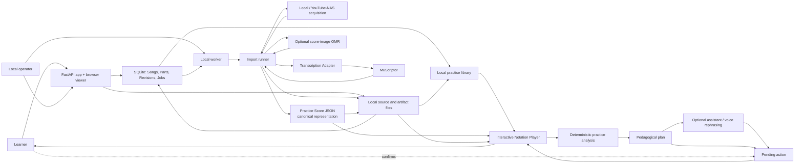

# Hallazgos de producto

## Confirmación del análisis

La definición canónica está en `docs/product/`; la validación ProductShape ejecutada con:

```sh
npx --yes @prodshape/cli@0.22.0 validate
```

resultó en `0 error(s), 0 warning(s) across 52 artifact(s)`.

La lectura siguió este orden:

1. `docs/product/README.md`
2. `docs/product/architecture.md`
3. `docs/product/model/`
4. Código y pruebas referenciados por cada artefacto de producto

---

## 1. Propósito y frontera

**DrumCoach convierte material musical seleccionado por el aprendiz en material de práctica específico por instrumento, lo persiste localmente y permite leerlo y reproducirlo con sincronización entre notación y playback.**

Evidencia principal:

- `docs/product/architecture.md:5-9`
- `docs/product/model/actors/act-learner.md:13-23`
- `docs/product/model/journeys/jrn-import-and-practise.md:16-29`
- `src/drumcoach_app/main.py:870-1011`
- `src/drumcoach_app/repository.py:188-255`

La frontera actual es **local-first y de uso personal**:

- FastAPI local
- SQLite local
- archivos de fuentes y artefactos bajo rutas configurables
- worker local
- runtimes opcionales locales

No forman parte de la frontera de producto estable:

- catálogo público alojado
- autenticación o cuentas
- API pública de transcripción
- cola distribuida
- scheduler de retries de producción
- contrato de soporte operativo

Evidencia:

- `docs/product/architecture.md:5-9,101-108`
- `docs/product/model/business-rules/br-local-first.md:13-24`
- `docs/product/model/requirements/constraints/con-local-sqlite.md:13-20`

---

## 2. Actores

### Learner

Actor principal. Aporta o selecciona material, elige instrumento, revisa la partitura, selecciona secciones, reproduce, repite y usa orientación contextual cuando está disponible.

- `docs/product/model/actors/act-learner.md:13-23`
- `docs/product/model/use-cases/uc-import-source.md:16-35`
- `docs/product/model/use-cases/uc-practise-score.md:16-35`

Corroboración:

- endpoints de importación: `src/drumcoach_app/main.py:879-1011`
- biblioteca: `src/drumcoach_app/main.py:1231-1261`
- práctica de una parte: `src/drumcoach_app/main.py:1291-1470`

### Local operator

Responsable de instalar dependencias, lanzar aplicación y worker, configurar rutas y revisar fallos o artefactos.

- `docs/product/model/actors/act-local-operator.md:13-23`
- `docs/product/model/use-cases/uc-run-local-worker.md:16-35`
- `src/drumcoach_app/local_worker_cli.py:14-55`
- `scripts/run-local-app.sh:16-28,81-90`

### MuScriptor transcription engine

Sistema externo local que genera eventos de audio para un perfil de instrumento. No es la fuente canónica del score.

- `docs/product/model/actors/act-muscriptor.md:13-23`
- `src/drumcoach_spike/transcription_adapter.py:39-44,138-198`

El adapter aplica máscaras por familia:

- drums → `drums`
- keyboard → `acoustic_piano`
- guitar → familias acústicas y eléctricas de guitarra

- `src/drumcoach_spike/transcription_adapter.py:20-36`

### Optional score-image OMR runtime

Sistema externo opcional que convierte una captura PNG, JPEG o WebP en MusicXML para una importación de teclado.

- `docs/product/model/actors/act-omr-runtime.md:13-23`
- `src/drumcoach_spike/omr.py:1-7,35-57`
- `src/drumcoach_spike/omr.py:80-114`

Su ausencia no impide arrancar la aplicación; produce un fallo durable del job.

- `docs/product/model/behaviours/sb-score-image-omr-failure.md:7-28`
- `src/drumcoach_app/import_runner.py:245-284`

### Runtimes de voz

Son una capa opcional de interacción alrededor del asistente, no un actor que controle directamente el reproductor.

- `docs/product/model/requirements/constraints/con-optional-voice.md:13-20`
- `src/drumcoach_app/voice/actions.py:163-202`

El recovery brief también enumera `Developer` como actor conocido, pero no existe una ficha equivalente en `docs/product/model/actors/`. Por tanto, no lo trato como actor de dominio principal; la operación de instalación y ejecución está representada por `Local operator`.

---

## 3. Casos de uso y journeys

### Importar material

El sistema valida, encola y expone el estado de una importación:

- audio local
- URL YouTube/NAS
- raw events
- score image

- `docs/product/model/use-cases/uc-import-source.md:16-35`
- `docs/product/model/requirements/functional/fr-import-source.md:17-21`
- `src/drumcoach_app/repository.py:100-103`
- `src/drumcoach_app/main.py:970-1011`

El flujo multiinstrumento crea un `Song`, partes independientes y jobs hijos:

- `docs/product/model/business-rules/br-instrument-specific-jobs.md:13-24`
- `src/drumcoach_app/repository.py:380-431`
- `src/drumcoach_app/main.py:908-917`

También existen imports standalone de una familia:

- `src/drumcoach_app/main.py:1013-1121`

### Importar una imagen de partitura

La rama de score image:

1. valida formato y tamaño
2. conserva la captura
3. crea un job de teclado
4. invoca OMR
5. convierte MusicXML a eventos canónicos
6. publica score y provenance

- `docs/product/model/use-cases/uc-import-score-image.md:16-35`
- `docs/product/model/journeys/jrn-score-image-import.md:16-29`
- `src/drumcoach_app/main.py:920-968`
- `src/drumcoach_app/import_runner.py:245-277`

### Ejecutar el worker local

El worker procesa jobs localmente, uno por vez, recorriendo los tipos de fuente y manteniendo el estado persistido.

- `docs/product/model/use-cases/uc-run-local-worker.md:16-35`
- `src/drumcoach_app/local_worker_cli.py:14-55`
- `src/drumcoach_app/main.py:185-228`

Los jobs `running` que quedaron huérfanos después de un reinicio se marcan como `failed`.

- `src/drumcoach_app/main.py:185-202`
- `docs/product/model/requirements/quality/qr-local-availability.md:8-20`

### Explorar la biblioteca local

La biblioteca permite localizar canciones, partes, revisiones activas, jobs pendientes y fallos visibles.

- `docs/product/model/use-cases/uc-browse-library.md:15-34`
- `src/drumcoach_app/main.py:1231-1306`
- `src/drumcoach_app/repository.py:486-525`

### Practicar un score activo

El reproductor carga la revisión activa, la notación derivada y el playback generado desde la misma base canónica.

- `docs/product/model/use-cases/uc-practise-score.md:16-35`
- `src/drumcoach_app/main.py:1308-1470`
- `src/drumcoach_app/player.py:316-386`

Controles confirmados:

- selección de compases
- reproducción, pausa y stop
- loop
- tempo
- metrónomo
- count-in
- fuente de playback
- filtro de voces de batería
- cambio de instrumento cuando existe conversión

- `src/drumcoach_app/player.py:412-507`
- `src/drumcoach_app/player.py:138-177`

### Orientación contextual

El teacher:

1. resuelve el contexto de selección
2. analiza determinísticamente los eventos
3. genera un plan pedagógico
4. puede reexpresarlo mediante el asistente
5. mantiene cualquier acción de playback pendiente hasta confirmación

- `docs/product/model/use-cases/uc-ask-practice-teacher.md:15-35`
- `src/drumcoach_app/teacher/analyse.py:32-95`
- `src/drumcoach_app/teacher/pedagogy.py:1-7`
- `src/drumcoach_app/assistant/tools.py:909-1043,1423-1455`
- `tests/test_teacher_tools.py:200-228`

---

## 4. Bounded contexts

El modelo de producto define **cuatro bounded contexts**:

### BC-PRACTICE-MATERIAL — Practice Material

Responsable de:

- Song
- Source Recording
- Instrument Part
- Practice Score
- Practice Score Revision
- material derivado

- `docs/product/model/domain/bounded-contexts/bc-practice-material.md:12-22`
- `src/drumcoach_app/repository.py:188-223`

### BC-TRANSCRIPTION — Instrument-Specific Ingestion

Responsable de adquirir o leer fuentes y producir revisiones específicas por instrumento.

- `docs/product/model/domain/bounded-contexts/bc-transcription.md:12-22`
- `src/drumcoach_app/main.py:970-1121`
- `src/drumcoach_app/import_runner.py:192-285`
- `src/drumcoach_spike/transcription_adapter.py:39-198`

### BC-PRACTICE-PLAYBACK — Interactive Notation Player

Responsable de proyectar la revisión activa con notación, playback generado, referencia, metrónomo, count-in, selección y controles de transporte.

- `docs/product/model/domain/bounded-contexts/bc-practice-playback.md:12-22`
- `src/drumcoach_app/player.py:316-507`
- `src/drumcoach_app/main.py:1364-1470`
- `src/drumcoach_app/generated_playback.py:47-73`

### BC-PRACTICE-COACHING — Contextual Practice Coaching

Responsable del análisis determinista, plan pedagógico, vocalización, reexpresión acotada y confirmación de acciones.

- `docs/product/model/domain/bounded-contexts/bc-practice-coaching.md:12-22`
- `src/drumcoach_app/teacher/analyse.py:32-95`
- `src/drumcoach_app/assistant/tools.py:911-1011,1423-1451`
- `src/drumcoach_app/voice/actions.py:163-202`

`docs/product/architecture.md:11-21` describe además cinco áreas runtime y una capacidad adicional de teacher. Esa es una vista de implementación; no la elevo a nuevos bounded contexts porque el modelo aceptado enumera cuatro.

---

## 5. Reglas de negocio

### Practice Score JSON es canónico

MusicXML, MIDI, summaries, diagnostics y engraving son derivados.

- `docs/product/model/business-rules/br-score-json-canonical.md:14-24`
- `docs/product/model/business-rules/br-derived-artifacts.md:14-24`
- `src/drumcoach_spike/practice_score.py:99-116,176-250`
- `src/drumcoach_app/import_runner.py:442-505`

El código publica, entre otros:

- `practice-score.json`
- `practice-score.musicxml`
- `normalized-events.json`
- `source-provenance.json`
- `conversion-summary.json`
- diagnostics
- `note-trace.json`

- `src/drumcoach_app/import_runner.py:461-512`
- `tests/test_import_runner.py:19-67`

### Las importaciones son específicas por instrumento

Cada job declara instrumento, perfil y tamaño de modelo. Un bundle puede crear jobs hijos independientes bajo un mismo `Song`.

- `docs/product/model/business-rules/br-instrument-specific-jobs.md:14-24`
- `src/drumcoach_app/repository.py:237-255,380-431`

La exploración directa de MIDI es una excepción no canónica:

- `src/drumcoach_spike/transcription_adapter.py:200-205`
- `src/drumcoach_app/main.py:505-550`

### La provenance se conserva

Los eventos raw, normalizados, configuración, hash de fuente, versión de mapping y diagnósticos deben permanecer inspeccionables.

- `docs/product/model/requirements/functional/fr-retain-provenance.md:17-21`
- `src/drumcoach_app/import_runner.py:465-505`

### Las revisiones no reemplazan silenciosamente el historial

La persistencia mantiene revisiones separadas y una referencia activa por parte.

- `docs/product/model/requirements/functional/fr-persist-score.md:17-21`
- `src/drumcoach_app/repository.py:213-223,627-714`

### El teacher es grounded y confirm-first

Los hechos musicales salen de analizadores deterministas. El modelo puede reexpresar o proponer, pero no calcular ticks, inventar hechos ni ejecutar playback sin confirmación.

- `docs/product/model/business-rules/br-human-review-teacher.md:14-24`
- `docs/product/model/domain/bounded-contexts/bc-practice-coaching.md:18-22`
- `src/drumcoach_app/teacher/analyse.py:39-95`
- `src/drumcoach_app/assistant/tools.py:911-913,1441-1451`
- `tests/test_teacher_tools.py:200-228`

### Los fallos son estados de producto

Un job fallido conserva su error y no se presenta como exitoso. La ausencia de runtimes opcionales no derriba la aplicación.

- `docs/product/model/behaviours/sb-import-score.md:7-24`
- `docs/product/model/behaviours/sb-score-image-omr-failure.md:7-28`
- `src/drumcoach_app/repository.py:932-972`
- `src/drumcoach_app/import_runner.py:278-284`

---

## 6. Restricciones y límites

### Infraestructura

- baseline documentado: macOS local
- Python `>=3.11`
- `uv`
- FFmpeg para las rutas de audio
- SQLite local
- archivos locales para fuentes y artefactos
- Docker no es requisito del flujo v1

- `docs/product/model/requirements/constraints/con-macos-local-runtime.md:13-20`
- `docs/product/model/requirements/constraints/con-local-sqlite.md:13-20`
- `scripts/run-local-app.sh:16-28`

### Fuentes e instrumentos

Fuentes registradas:

- `raw_events`
- `local_audio`
- `youtube_url`
- `score_image`

Instrumentos:

- `drums`
- `keyboard`
- `guitar`

Tamaños de modelo:

- `small`
- `medium`
- `large`

- `src/drumcoach_app/repository.py:100-103`
- `src/drumcoach_app/main.py:99-113`

### Audio

- formatos de upload: WAV, MP3, FLAC, OGG, M4A, AAC
- límite de upload local: 100 MB
- duración máxima de transcripción: 10 minutos
- las búsquedas YouTube descartan resultados por encima de ese límite

- `src/drumcoach_app/main.py:879-900`
- `src/drumcoach_spike/audio_duration.py:10,54-59`
- `src/drumcoach_spike/source_acquisition.py:145-151`

### Score image

- formatos aceptados: PNG, JPEG y WebP
- límite: 25 MB
- PDF rechazado
- solo produce importación de teclado
- requiere OMR local configurado

- `docs/product/model/requirements/constraints/con-optional-omr.md:13-20`
- `src/drumcoach_app/main.py:920-960`
- `src/drumcoach_spike/omr.py:51-114`

### Integraciones opcionales

OMR, voz y MuseScore pueden no estar disponibles. La aplicación debe conservar un estado visible y recuperable.

- `docs/product/model/requirements/quality/qr-local-availability.md:17-22`
- `docs/product/architecture.md:57-67`

### Alcance experimental

La propia arquitectura marca coaching, voz, piano, guitarra, multiinstrumento y engraving como capacidades experimentales u opt-in en distintos grados. El código confirma que existen seams funcionales, pero no deben interpretarse como requisitos universales del núcleo.

- `docs/product/architecture.md:9,101-108`
- `src/drumcoach_app/main.py:1013-1121`
- `src/drumcoach_app/voice/actions.py:163-202`

---

## 7. Flujo confirmado



### Conclusión

El producto no es principalmente un transcriptor ni un editor de partituras. Es una **cadena local de ingestión → material canónico de práctica → proyecciones de notación/playback → práctica guiada**, con provenance y estados de fallo como requisitos estructurales.
